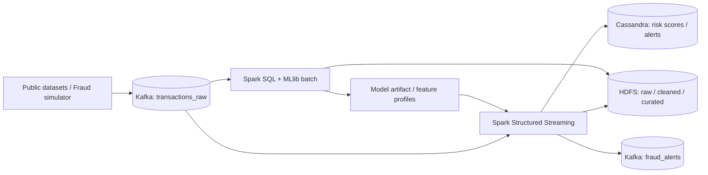

# Checkpoint 1 — FraudStream: W1 và W2

> Cập nhật 21/10/2026. Tài liệu là nguồn nội dung cho báo cáo checkpoint 1.
> Mỗi kết quả được ghi rõ: đã chạy, đã có mã/tài liệu, hoặc chưa hoàn thành.

## 1. Bài toán

FraudStream phát hiện gian lận thanh toán trực tuyến gần thời gian thực. Mỗi
giao dịch là một event, được kiểm tra chất lượng, tính tín hiệu hành vi và
gán `risk_score` cùng quyết định `APPROVE`, `REVIEW` hoặc `BLOCK`.

| Kịch bản | Dấu hiệu |
|---|---|
| Normal | Không vượt ngưỡng rủi ro |
| Card testing | `failed_tx_count_10m >= 3` |
| Velocity fraud | `tx_count_5m >= 5` |
| Device sharing | `unique_cards_per_device_1h >= 3` |
| High-value anomaly | `amount_vs_avg_7d >= 5` |

## 2. Data thật và simulator

Hai nguồn bổ trợ nhau. Data thật dùng cho EDA, imbalance, baseline ML và
đánh giá offline. Simulator tạo event stream tái lập được để test Kafka,
Spark, HDFS, Cassandra và những hành vi mà data công khai không thể hiện đủ
(card testing, velocity, device sharing, invalid/duplicate/late event).

> Metric model chỉ đánh giá trên dữ liệu thật. Simulator không được dùng để
> tuyên bố accuracy model; nó dùng để kiểm thử pipeline và demo có kiểm soát.

## 3. Thiết kế hệ thống



| Layer | Trạng thái |
|---|---|
| Simulator + data contract | Đã có |
| Kubernetes + Kafka + Cassandra | Đã có |
| HDFS | Chưa có implementation |
| Spark batch, Spark streaming, ML model, dashboard | Chưa có |

## 4. Kết quả W1

### 4.1. Data contract và chất lượng dữ liệu

Đã định nghĩa transaction event v1 gồm 12 trường như `transaction_id`,
`event_time` UTC, `card_id_hash`, `amount`, `device_id_hash`,
`transaction_status`.

- `transaction_id`: idempotency key để deduplicate.
- `card_id_hash`: Kafka key để giữ hành vi một thẻ trong cùng partition.
- Toàn bộ định danh nhạy cảm là synthetic SHA-256 hash.
- Thứ tự phân loại: `invalid -> duplicate -> late -> valid`.
- Watermark khởi điểm: 10 phút; `amount <= 0` là invalid.

Nguồn: [data_dictionary.md](data_dictionary.md).

### 4.2. EDA dữ liệu thật

EDA ULB Credit Card Fraud Detection đã cho các kết quả sau:

| Chỉ số | Giá trị |
|---|---:|
| Số giao dịch | 284,807 |
| Fraud | 492 |
| Fraud rate | 0.173% |
| Non-fraud : fraud | khoảng 578 : 1 |
| Duplicate hoàn toàn | 1,081 |
| Missing value | 0 |

Kết luận: accuracy không đủ cho fraud detection; dùng Precision, Recall,
F1, PR-AUC, FPR. Amount lệch phải mạnh nên cần feature tương đối/lịch sử,
không chỉ ngưỡng amount tuyệt đối. Đã có sáu biểu đồ cho imbalance, amount,
fraud rate theo amount/thời gian, boxplot và correlation.

Nguồn: [eda_report.md](eda_report.md) và [EDA notebook](../notebooks/eda_ulb.ipynb).

### 4.3. Feature v1

Đã đặc tả `tx_count_5m`, `amount_sum_1h`, `failed_tx_count_10m`,
`unique_cards_per_device_1h`, `amount_vs_avg_7d`, `is_new_merchant`,
`is_new_country`. Mỗi feature có key, event-time window, cold-start,
batch/streaming feasibility và kiểm tra data leakage.

Nguyên tắc: không dùng label, dữ liệu tương lai hoặc thông tin hậu giao dịch;
chia train/validation/test theo thời gian. Nguồn: [feature_v1.md](feature_v1.md).

### 4.4. Simulator và test W1 — đã chạy

Mã nguồn: `data-generator/producer.py`, `scenarios.py`, `schema.py`.
Simulator hỗ trợ năm scenario, `seed`/`rate`/`duration`, JSONL, quality cases
và gửi Kafka qua `--bootstrap-server`.

Lệnh đã chạy ngày 19/10/2026:

```bash
python3 data-generator/producer.py \
  --scenario velocity_fraud --seed 42 --rate 20 --duration 5 \
  --output out/checkpoint_velocity.jsonl \
  --quality-output out/checkpoint_quality.jsonl
python3 scripts/check_simulator_plausibility.py \
  --file out/checkpoint_velocity.jsonl --expect velocity_fraud
```

Kết quả: 108 event hợp lệ; không lỗi JSON/duplicate; `max(tx_count_5m) = 8`;
plausibility checker `PASS`. Toàn bộ test hiện có: **27 passed**.

## 5. Kết quả W2

### 5.1. Kubernetes platform — đã có

- Kind cluster `fraudstream-cluster`, namespace `fraudstream`.
- Kubernetes 1.34.11 đã pin trong config.
- ResourceQuota, LimitRange, Bash/PowerShell preflight.
- Preflight kiểm tra Docker, node, CoreDNS, StorageClass `standard`, PVC
  `Bound`, mount và read/write qua pod tạm.

### 5.2. Kafka — đã có và đã chạy thực tế

- Kafka 3.9.1 KRaft, một broker/controller, StatefulSet và PVC 5 GiB.
- Service nội bộ: `kafka.fraudstream.svc.cluster.local:9092`.
- Bốn topic: `transactions_raw`, `transactions_invalid`, `fraud_alerts`,
  `fraud_feedback`.
- Bootstrap idempotent, có health probes và smoke test.

Evidence runtime: pod/PVC healthy; gửi-đọc đúng 100 event; JSON/schema/key
hợp lệ; dữ liệu còn nguyên sau recreate broker/client trên cùng PVC/PV.

### 5.3. Cassandra — đã có evidence smoke test

- Single-node StatefulSet, PVC 5 GiB, service nội bộ, readiness/liveness probe.
- Keyspace `fraudstream`; bảng `transaction_risk`, `fraud_alert`.
- Khoá truy vấn: `PRIMARY KEY ((card_id_hash), event_time, transaction_id)`.
- Đã có evidence node `UN`, CQL bootstrap, insert/select `APPROVE` + `BLOCK`,
  persistence sau recreate pod.

### 5.4. Cải thiện chất lượng W2

1. Pin Kind theo phiên bản môi trường Kafka đã kiểm thử; bỏ port mapping thừa.
2. Preflight không còn coi PVC `Pending` là pass.
3. Full verifier fail khi thiếu CoreDNS, Cassandra schema/query, HDFS NameNode
   hoặc các HDFS path bắt buộc.
4. Xóa Secret Cassandra mẫu có password hard-code nhưng không được dùng.
5. Cassandra smoke test kiểm tra đủ hai transaction và hai quyết định nghiệp vụ.

### 5.5. W2 chưa hoàn tất

| Hạng mục | Trạng thái |
|---|---|
| HDFS NameNode/DataNode/PVC | Chưa có |
| Data lake layout, I/O, checksum, persistence | Chưa có |
| Full `verify_infra` | Chưa pass vì thiếu HDFS |
| Review chéo W2 | Chưa hoàn tất |

Không trình bày HDFS/full pipeline như đã chạy; log HDFS cũ chỉ là mẫu, không
phải evidence nghiệm thu.

## 6. Tiến độ

| Gói công việc | Trạng thái |
|---|---|
| W1: architecture, contract, EDA, feature, simulator | Hoàn thành |
| Kubernetes, Kafka, Cassandra | Hoàn thành, có evidence |
| HDFS và full W2 verification | Chưa hoàn thành |
| Spark batch/streaming, ML, dashboard | Chưa bắt đầu |

## 7. Kịch bản checkpoint 1

1. Bài toán và lý do dùng data thật + simulator — 1–2 phút.
2. Lambda architecture và vai trò Kafka/HDFS/Cassandra/Spark — 1 phút.
3. EDA: show class imbalance, amount distribution, fraud rate theo amount — 2 phút.
4. Data contract + feature v1, nhấn mạnh anti-leakage — 2 phút.
5. Demo simulator `velocity_fraud`, mở JSONL và checker PASS — 2 phút.
6. Show Kafka 100-event/persistence và Cassandra CQL evidence — 2 phút.
7. Nêu HDFS là blocker cho end-to-end, sau đó là batch pipeline — 1 phút.

Không cuộn toàn bộ source. Chỉ show `producer.py` (CLI/Kafka key),
`kafka.yaml` (StatefulSet/PVC/Service), `02-smoke-test.cql` (query key) và
log PASS ngắn.

## 8. Lệnh demo

```bash
python3 -m pytest tests -q
python3 data-generator/producer.py --scenario velocity_fraud --seed 42 \
  --rate 20 --duration 5 --output out/velocity.jsonl
python3 scripts/check_simulator_plausibility.py \
  --file out/velocity.jsonl --expect velocity_fraud

# Khi cluster đã chạy
bash infra/kafka/bootstrap_topics.sh
python3 infra/kafka/smoke_test.py --test-persistence
bash infra/cassandra/smoke_test.sh --test-persistence
```

## 9. Tài liệu nguồn

- [Bài toán và kiến trúc](problem_and_architecture.md)
- [Tích hợp W1](week1_integration.md)
- [Mục tiêu/trạng thái W2](week_2_target.md)
- [Deploy W2](week_2_deployment.md)
- [Evidence W2](week_2_test_evidence.md)
