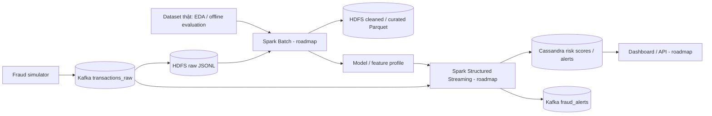

# Checkpoint 1 — FraudStream: W1 và W2

> Cập nhật 25/10/2026. Tài liệu này là nguồn nội dung cho checkpoint 1. Mỗi
> kết quả được phân biệt rõ giữa **đã chạy có output**, **đã có mã/tài liệu**
> và **phần roadmap chưa triển khai**.

## 1. Bài toán

FraudStream phát hiện sớm gian lận thanh toán trực tuyến gần thời gian thực.
Mỗi giao dịch là một event có thời điểm phát sinh, định danh đã băm và thông
tin giao dịch. Hệ thống kiểm tra chất lượng dữ liệu, tổng hợp hành vi theo
event time, sau đó tạo `risk_score` và một trong ba quyết định:

| Quyết định | Ý nghĩa nghiệp vụ |
|---|---|
| `APPROVE` | Rủi ro thấp, giao dịch được chấp nhận |
| `REVIEW` | Có tín hiệu đáng ngờ, cần kiểm tra thêm |
| `BLOCK` | Rủi ro cao, cần tạm chặn |

| Kịch bản fraud | Dấu hiệu ban đầu |
|---|---|
| Normal | Không vượt ngưỡng rủi ro |
| Card testing | `failed_tx_count_10m >= 3` |
| Velocity fraud | `tx_count_5m >= 5` |
| Device sharing | `unique_cards_per_device_1h >= 3` |
| High-value anomaly | `amount_vs_avg_7d >= 5` |

Mục tiêu checkpoint không phải tuyên bố đã có model fraud hoàn chỉnh. Mục tiêu
là chứng minh nhóm đã hiểu bài toán, chuẩn hóa event, có simulator/data thật
cho hai mục đích khác nhau và đã dựng nền tảng dữ liệu có thể nhận-lưu-kiểm tra
sự kiện một cách tái lập.

### 1.1. Bài toán nghiệp vụ được giải quyết như thế nào?

Một giao dịch online xuất hiện trước khi tổ chức biết chắc nó có phải fraud hay
không. Vì vậy hệ thống chỉ được dùng tín hiệu quan sát được tại thời điểm giao
dịch, không được dùng chargeback hay kết quả điều tra đến sau đó. Mục tiêu là
giảm tổn thất fraud nhưng cũng tránh chặn nhầm khách hàng hợp lệ:

1. Client/payment gateway phát sinh transaction event.
2. Pipeline kiểm tra schema, ràng buộc và bản phát lại; record không đạt bị
   quarantine, không được tính feature/score.
3. Với record hợp lệ, speed layer sẽ dùng lịch sử có trước `event_time` để
   tính velocity, failed transaction, device sharing và amount bất thường.
4. Rule engine/model (milestone sau) trả `risk_score` và `APPROVE`, `REVIEW`
   hoặc `BLOCK`. `REVIEW` là vùng cân bằng khi bằng chứng chưa đủ để block.
5. Chargeback/manual review tạo feedback đến trễ cho đánh giá và train lại;
   feedback không được quay lại làm feature cho chính giao dịch đã score.

Fraud rất hiếm nên accuracy không đủ ý nghĩa: model luôn `APPROVE` vẫn có thể
có accuracy cao nhưng bỏ sót phần lớn fraud. Giai đoạn model sẽ đánh giá
Precision, Recall, F1, PR-AUC, False Positive Rate và latency event-to-decision.

### 1.2. Danh mục sự kiện và ý nghĩa

| Event / nơi lưu | Khi nào xuất hiện | Ý nghĩa | Dùng để score online? |
|---|---|---|---|
| `transactions_raw` | Producer/simulator phát giao dịch | Event 12 field v1 bất biến để audit và replay. | Có, sau validation. |
| `transactions_invalid` | Sai schema/DQ, ví dụ thiếu field hoặc amount không dương | Quarantine kèm mã lỗi; dùng sửa nguồn và đo chất lượng data. | Không. |
| Duplicate | `transaction_id` đã xuất hiện | Bản retry/phát lại; loại để không double-count feature và score. | Không. |
| Late event | Hợp lệ schema nhưng cũ hơn watermark | Giữ riêng để đối soát/backfill, không làm đổi state online tùy tiện. | Không ở luồng đúng hạn. |
| Valid transaction | Qua validation, unique, trong watermark | Input tin cậy cho window feature và cleaned/curated layer. | Có. |
| `fraud_alerts` | Streaming layer quyết định `REVIEW`/`BLOCK` | Output cho analyst, dashboard hoặc downstream action. | Là output. |
| `fraud_feedback` | Chargeback/manual review có nhãn xác nhận | Ground truth đến trễ cho đánh giá, train lại và drift monitoring. | Không dùng cho cùng event. |
| Cassandra `transaction_risk` | Sau online scoring (roadmap) | Serving record để API truy vấn nhanh score/quyết định theo card/time. | Là output. |

**Invalid, duplicate và late không giống nhau:** invalid là dữ liệu sai;
duplicate là dữ liệu hợp lệ nhưng bị phát lại; late là dữ liệu hợp lệ đến muộn.
Tách ba nhánh này giữ được trace, chất lượng số liệu và tính đúng đắn state.

## 2. Nguồn dữ liệu và simulator

Hai nguồn dữ liệu bổ trợ nhau, không thay thế nhau:

| Nguồn | Dùng để làm gì | Không dùng để làm gì |
|---|---|---|
| ULB Credit Card Fraud Detection | EDA, đo class imbalance, baseline ML và đánh giá offline | Mô phỏng đầy đủ event-time, thẻ/thiết bị/IP thực tế |
| Fraud simulator | Test Kafka/HDFS/Cassandra/Spark, demo tái lập, tạo velocity/late/duplicate/invalid | Khẳng định accuracy hay PR-AUC của model |

EDA từ ULB có 284,807 giao dịch, 492 fraud (0.173%), tỷ lệ non-fraud : fraud
khoảng 578 : 1, 1,081 duplicate hoàn toàn và không có missing value. Vì fraud
rất hiếm, accuracy không đủ ý nghĩa; các chỉ số cần dùng ở giai đoạn model là
Precision, Recall, F1, PR-AUC và False Positive Rate.

Simulator sinh event theo seed để hai lần chạy cùng tham số cho kết quả có thể
kiểm tra. Nó tạo cả traffic bình thường lẫn pattern fraud, đồng thời tạo được
quality cases mà dataset công khai không mô tả đầy đủ.

## 3. Data contract và nguyên tắc xử lý

`transaction_event_v1` có 12 trường bắt buộc, bao gồm `transaction_id`,
`event_time` UTC, `customer_id`, `card_id_hash`, `merchant_id`, `amount`,
`currency`, `channel`, `device_id_hash`, `ip_hash`, `country` và
`transaction_status`.

| Thành phần contract | Quy ước | Lý do |
|---|---|---|
| `transaction_id` | Idempotency key | Phát hiện và loại bản ghi trùng |
| `card_id_hash` | Kafka message key | Các event của cùng thẻ đi vào cùng partition, hỗ trợ feature theo thẻ |
| `event_time` UTC | Thời điểm nghiệp vụ, không phải thời điểm hệ thống nhận event | Dùng cho window, watermark và partition ngày |
| Định danh nhạy cảm | Synthetic hoặc SHA-256 hash | Không đưa PII vào repository/demo |
| Thứ tự quality | `invalid → duplicate → late → valid` | Bản ghi sai schema không được đi tiếp; duplicate không tạo tín hiệu kép |
| Watermark khởi điểm | 10 phút | Tách event đến trễ khỏi luồng xử lý đúng hạn |

Feature v1 gồm `tx_count_5m`, `amount_sum_1h`, `failed_tx_count_10m`,
`unique_cards_per_device_1h`, `amount_vs_avg_7d`, `is_new_merchant` và
`is_new_country`. Nguyên tắc bắt buộc là feature tại thời điểm *t* không được
dùng label, future event hay thông tin hậu giao dịch. Đây là cách tránh data
leakage khi train/evaluate model sau này.

## 4. Lambda Architecture của FraudStream

Lambda Architecture kết hợp hai cách xử lý cùng dùng một nguồn event:

- **Speed layer** xử lý event mới nhanh để ra score/alert gần thời gian thực.
- **Batch layer** đọc lịch sử để làm sạch, tổng hợp feature, train/evaluate
  model và có thể backfill dữ liệu đến trễ.
- **Serving layer** phục vụ truy vấn kết quả score/alert nhanh cho ứng dụng hay
  dashboard.



| Chặng | Trạng thái | Ý nghĩa |
|---|---|---|
| Simulator → Kafka | Đã chạy | Chứng minh event có schema/key đi vào event bus |
| Kafka → HDFS raw | Đã chạy | Giữ JSONL bất biến để audit/replay/batch xử lý |
| Raw → cleaned/curated Parquet | Đã thiết kế contract | Batch Spark là milestone sau checkpoint |
| Streaming score → Cassandra/alerts | Chưa triển khai | Thuộc Structured Streaming/model milestone |
| Dashboard/model metrics | Chưa triển khai | Thuộc tuần dashboard/ML |

HDFS raw không phải là nơi “ra quyết định fraud”; nó là nguồn lịch sử bền vững
để Spark đọc lại. Cassandra cũng không thay HDFS: Cassandra tối ưu cho truy
vấn score/alert theo khóa trong thời gian ngắn, còn HDFS tối ưu lưu file lớn và
scan/ETL batch.

## 5. Công cụ sử dụng và nhiệm vụ trong hệ thống

| Công cụ | Là gì | Vai trò cụ thể trong FraudStream | Trạng thái checkpoint |
|---|---|---|---|
| Docker Desktop | Runtime chạy container local | Cung cấp nền cho Kind và image của các service | Đã chạy |
| Kind | Kubernetes chạy trong Docker | Dựng cluster local tái lập `fraudstream-cluster` | Đã chạy, pin Kubernetes v1.34.11 |
| Kubernetes | Hệ thống điều phối container | Chạy StatefulSet, Service, ConfigMap, PVC, probe và quota | Đã chạy |
| Kafka | Distributed event streaming platform | Nhận `transactions_raw`, giữ thứ tự theo key/partition, cung cấp event cho consumer | Đã chạy, 4 topic |
| HDFS | Distributed file system | Lưu `raw`, `cleaned`, `curated`, `late_events`, `checkpoints`, `models` | Đã chạy NameNode + DataNode |
| Cassandra | NoSQL wide-column database | Serving store cho risk score/alert, query theo `card_id_hash` và event time | Đã chạy 1 node local |
| Spark SQL / MLlib | Engine batch + machine learning | ETL raw→Parquet, feature engineering, train/evaluate model | Roadmap, chưa chạy |
| Spark Structured Streaming | Event processing engine | Dedup, watermark, online feature/scoring và phát alert | Roadmap, chưa chạy |
| Python simulator | Chương trình sinh event có kiểm soát | Sinh 5 scenario, validate schema, phục vụ test/demo | Đã chạy |
| pytest | Framework kiểm thử Python | Kiểm tra generator, schema, quality và batch fixture | Đã chạy |
| Make | Task runner | Chuẩn hóa `reproduce`, `verify`, `integration`, `persistence` cho máy khác | Đã chạy |

### Vì sao dùng StatefulSet và PVC?

Kafka, Cassandra và HDFS lưu state. `StatefulSet` giữ tên pod ổn định như
`kafka-0` hoặc `hdfs-namenode-0`; `PersistentVolumeClaim` (PVC) gắn một volume
cho pod để data không mất khi pod bị recreate. Trong demo local, persistence
chỉ được chứng minh qua pod restart cùng Kind cluster; xóa cluster sẽ xóa data
local.

### 5.1. Cấu hình hiện tại: giá trị, ý nghĩa và lý do chọn

| Thành phần | Cấu hình hiện tại | Ý nghĩa và lý do |
|---|---|---|
| Kind | Một control-plane, image Kubernetes `v1.34.11` được pin | Mọi máy tạo cùng K8s version, giảm lỗi khác biệt môi trường. Một node là đủ local demo, không giả định HA. |
| Namespace/quota | `fraudstream`; request tối đa 4 CPU/8 GiB, limit 8 CPU/12 GiB, tối đa 10 PVC | Cô lập project và chặn workload vượt năng lực laptop trước khi rơi vào Pending/OOM khó chẩn đoán. |
| Kafka runtime | 1 StatefulSet replica, Kafka 3.9.1, KRaft broker+controller, PVC 5 GiB | KRaft loại ZooKeeper nên ít dependency hơn cho demo. PVC giữ log qua restart; 1 broker không thể replication thật. |
| Kafka partition | Default 3; raw/alert 3 partition, invalid/feedback 1 partition | Ba partition đủ minh họa key-based partitioning và consumer song song. Invalid/feedback thấp hơn nên 1 partition giảm chi phí. |
| Kafka retention | Raw/alert 7 ngày; invalid 3 ngày; feedback 30 ngày | Raw đủ replay ngắn; invalid chỉ để sửa nguồn; feedback giữ lâu hơn cho nhãn đến trễ. Đây là policy demo, không phải SLA. |
| Kafka reliability | Smoke producer `acks=all`; RF=1, `min.insync.replicas=1` | Producer chờ broker xác nhận. RF/ISR bằng 1 là bắt buộc vì chỉ một broker; production cần nhiều broker/RF cao hơn. |
| Kafka health | Startup TCP 10s × 30; readiness bằng broker API; liveness TCP | Cho JVM/KRaft tối đa khoảng 5 phút; readiness kiểm tra API thật trước khi nhận traffic. |
| HDFS topology | 1 NameNode + 1 DataNode, Hadoop 3.2.1, `dfs.replication=1` | Mô hình metadata/block/data lake vừa laptop. RF=1 khớp 1 DataNode, tránh block under-replicated. |
| HDFS storage | NameNode PVC 5 GiB; DataNode PVC 8 GiB | NameNode giữ metadata, DataNode giữ raw/cleaned/curated blocks nên cần lớn hơn; không dùng `emptyDir` để persistence test có ý nghĩa. |
| HDFS network | NameNode RPC 9000/web 9870 qua ClusterIP DNS; WebHDFS bật | Service DNS không đổi khi pod đổi IP; RPC cho HDFS client, web cho health/UI trong demo. |
| HDFS probes | Startup tối đa 5 phút; readiness HTTP UI; liveness TCP RPC | HDFS/JVM khởi động chậm nên tránh restart sớm; chỉ nhận traffic khi service sẵn sàng. |
| Cassandra | Cassandra 4.1, 1 StatefulSet replica, PVC 5 GiB, CQL 9042 | Serving store theo key/time, footprint phù hợp local; không có quorum/HA thật. |
| Cassandra key | `PRIMARY KEY ((card_id_hash), event_time, transaction_id)` | Partition theo card để query lịch sử nhanh; event time sắp xếp; transaction ID chống va chạm timestamp. |
| Cassandra resources | Request 300m CPU/1 GiB, limit 1 CPU/1.5 GiB | JVM có baseline memory rõ ràng mà vẫn nằm trong quota laptop. |
| Data quality | Watermark 10 phút; `invalid → duplicate → late → valid` | Watermark là điểm bắt đầu dễ giải thích, sẽ tuning bằng event delay thật; thứ tự bảo đảm một record chỉ có một outcome. |
| Python/test | Python 3.12.7, dependency pin version, pytest, seed 42 | Tái lập môi trường và output; seed cố định giúp scenario test không flaky. |

### 5.2. Các giới hạn cấu hình local cần nói thẳng

- Một replica, RF=1 và HDFS replication=1 giúp chạy vừa laptop nhưng không
  chịu được mất node. Production cần nhiều broker/DataNode/Cassandra node,
  anti-affinity, replication, backup và disaster recovery.
- Kafka dùng `PLAINTEXT`, HDFS tắt permission check trong namespace học tập để
  giảm phức tạp checkpoint. Production cần TLS/SASL, ACL, secret management,
  network policy, authentication, authorization, audit và encryption.
- PVC 5–8 GiB và retention hiện tại là dung lượng demo. Production phải tính
  theo throughput, retention, replication, growth, RPO/RTO và ngân sách.
- Watermark 10 phút không phải hằng số nghiệp vụ; cần đo delay thực tế rồi cân
  bằng data completeness với độ trễ ra quyết định.

### Endpoint và storage contract quan trọng

| Thành phần | Endpoint/path | Hợp đồng sử dụng |
|---|---|---|
| Kafka | `kafka.fraudstream.svc.cluster.local:9092` | Key UTF-8 `card_id_hash`; value JSON UTF-8 event v1 |
| HDFS NameNode | `hdfs-namenode.fraudstream.svc.cluster.local:9000` | Raw JSONL immutable tại `/fraud-data/raw/` |
| HDFS cleaned/curated | `/fraud-data/cleaned/`, `/fraud-data/curated/` | Dành cho Parquet + Snappy, partition `event_date` ở batch phase |
| Cassandra | `cassandra.fraudstream.svc.cluster.local:9042` | Risk/alert query bằng partition key thẻ + event time |

## 6. Kết quả W1

- Có EDA notebook/report, nêu rõ imbalance, fraud rate và amount distribution.
- Có data dictionary, quality rules và fixture valid-invalid-duplicate-late.
- Có feature v1 kèm event-time window, cold start, batch/streaming feasibility
  và anti-leakage checks.
- `producer.py`, `scenarios.py`, `schema.py` hỗ trợ normal, card testing,
  velocity fraud, device sharing và high-value anomaly.

Kết quả chạy mới nhất ở cuối tài liệu: 108 `velocity_fraud` event đều
parse/validate được, không duplicate/out-of-order và có một thẻ đạt
`count_5m = 8`.

## 7. Kết quả W2 và bằng chứng runtime

### 7.1. Platform Kubernetes

Cluster Kind có một node Ready, namespace `fraudstream`, CoreDNS, StorageClass
`standard`, ResourceQuota/LimitRange và preflight PVC mount/read-write. Bốn
Stateful workload dưới đây đang Ready; cả bốn PVC Bound.

| Workload | Persistence | Nhiệm vụ |
|---|---|---|
| `kafka-0` | PVC 5 GiB | Broker KRaft, event topics |
| `cassandra-0` | PVC 5 GiB | Serving store score/alert |
| `hdfs-namenode-0` | PVC 5 GiB | Metadata và namespace HDFS |
| `hdfs-datanode-0` | PVC 8 GiB | Blocks dữ liệu HDFS |

### 7.2. Kafka

Kafka 3.9.1 chạy KRaft mode với 4 topic: `transactions_raw` (3 partitions,
7 ngày), `transactions_invalid` (1 partition, 3 ngày), `fraud_alerts` (3
partitions, 7 ngày) và `fraud_feedback` (1 partition, 30 ngày). RF=1 là lựa
chọn local demo, không phải cấu hình high availability.

Smoke test đã gửi/đọc 100/100 event, JSON không thay đổi, schema hợp lệ và key
khớp `card_id_hash`. Persistence test tạo lại broker/client với UID mới nhưng
PVC/PV giữ nguyên; dữ liệu vẫn đọc được.

### 7.3. Cassandra

Cassandra một node có keyspace `fraudstream`, bảng `transaction_risk` và
`fraud_alert`. Khóa chính của risk table là
`PRIMARY KEY ((card_id_hash), event_time, transaction_id)`: partition theo thẻ
để truy vấn lịch sử một thẻ nhanh, sắp theo thời gian và vẫn phân biệt từng
giao dịch.

`nodetool status` trả `UN` (Up/Normal). Smoke test insert/select đọc được hai
quyết định `APPROVE` và `BLOCK`, sau recreate pod dữ liệu vẫn còn. Trong lần
nghiệm thu đã phát hiện liveness probe tìm literal `${POD_IP}`; manifest đã sửa
để shell mở rộng biến và pod giữ `Ready`, restart count 0.

### 7.4. HDFS và integration

HDFS dùng một NameNode + một DataNode, replication factor 1. `dfsadmin report`
xác nhận `Live datanodes (1)`, không corrupt/missing/under-replicated block.
Bootstrap tạo sáu thư mục data lake. HDFS smoke test upload/list/cat JSONL,
so SHA-256 byte-for-byte; test persistence recreate NameNode và đọc lại cùng
file thành công.

Integration smoke tạo 100 normal event có schema hợp lệ, gửi và đọc Kafka với
key `card_id_hash`, rồi lưu cùng JSONL vào HDFS. Artefact runtime:

| Artefact | Giá trị kiểm tra |
|---|---|
| HDFS raw file | `/fraud-data/raw/integration_83721287ecfe.jsonl` |
| Số event | 100, schema valid |
| SHA-256 | `ea121af95b59aa9517b0587004b820b9995fdd4a768189fcd964dba235f68187` |
| HDFS smoke checksum | `2acff3efb3fd5171336c4edafe51ec659b7c1a6426a3040355eac3c7b58aa881` |

### 7.5. Tái lập và review chéo

`make reproduce` đã chạy thành công trên Kind: kiểm tra toolchain, preflight,
deploy, bootstrap, full Bash verifier và integration. Lần chạy tạo thêm
`/fraud-data/raw/integration_8ff18fcefdae.jsonl`. `verify_infra.sh` và
`verify_infra.ps1` đều kiểm tra platform, Cassandra, Kafka và HDFS.

Review chéo kỹ thuật đã kiểm tra runtime/manifests/scripts, tìm và sửa liveness
probe Cassandra, hard gate DataNode cho HDFS và mở rộng verifier. Chi tiết:
[`week_2_cross_review.md`](../week_2/week_2_cross_review.md).

## 8. Tiến độ, phạm vi và giới hạn

| Gói công việc | Trạng thái |
|---|---|
| W1: architecture, contract, EDA, feature, simulator | Hoàn thành |
| W2: Kubernetes, Kafka, HDFS, Cassandra và integration | Hoàn thành, có runtime evidence |
| Batch Spark raw → Parquet | Chưa triển khai; contract/fixture đã có |
| Streaming scoring, model ML, alert UI/dashboard | Chưa triển khai |

Giới hạn cần nói thẳng trong checkpoint:

1. HDFS/Kafka/Cassandra hiện một node, RF=1; chỉ phù hợp local demo.
2. Persistence chỉ chứng minh qua pod recreate trong cùng Kind cluster; không
   chứng minh chịu mất node, mất cluster hay HA.
3. Simulator xác minh pipeline, không xác minh chất lượng dự đoán fraud.
4. Spark/model/dashboard là roadmap, không trình bày như deliverable đã có.

## 9. Gợi ý trình bày checkpoint 1

1. **Bài toán và dữ liệu** (1.5 phút): fraud hiếm, vì sao cần Precision/
   Recall/PR-AUC; data thật bổ sung simulator thế nào.
2. **Data contract và quality** (1.5 phút): 12 trường, event-time,
   idempotency key, anti-leakage.
3. **Lambda Architecture** (2 phút): đi theo sơ đồ, giải thích rõ Kafka/HDFS/
   Cassandra khác nhau ra sao; đánh dấu phần Spark là roadmap.
4. **W1 proof** (1.5 phút): EDA plots, feature v1, simulator velocity output.
5. **W2 proof** (2.5 phút): 4 pods/PVC Bound, Kafka 100 events, HDFS checksum
   và Cassandra `UN`; chỉ show snippet log ngắn.
6. **Kết luận và next step** (1 phút): batch raw→Parquet, rồi streaming
   scoring/model/dashboard.

Không cuộn toàn bộ source. Nên mở đúng bốn vị trí: `producer.py` (schema/key),
`kafka.yaml` (StatefulSet/PVC/Service), HDFS raw file/checksum và CQL query
`transaction_risk` theo partition key.

## 10. Lệnh kiểm thử và output thực tế

Tất cả lệnh kiểm tra được gom tại đây. Chạy từ root repository. `make
reproduce` cần Docker Desktop, Kind, kubectl, Make và Python 3; nó tạo/tái sử
dụng cluster rồi chạy toàn bộ luồng W2 không-persistence. `make persistence`
chạy riêng các restart test vì mất nhiều thời gian hơn.

### 10.1. W1 — unit/integration test và simulator

```bash
python3 -m pytest tests -q
python3 data-generator/producer.py \
  --scenario velocity_fraud --seed 42 --rate 20 --duration 5 \
  --output out/checkpoint_velocity_20261025.jsonl \
  --quality-output out/checkpoint_quality_20261025.jsonl
python3 scripts/check_simulator_plausibility.py \
  --file out/checkpoint_velocity_20261025.jsonl --expect velocity_fraud
```

Output chạy ngày 25/10/2026:

```text
30 passed, 1 warning
Generated 108 valid velocity_fraud events -> out/checkpoint_velocity_20261025.jsonl
"n_lines_parsed": 108, "n_valid": 108, "n_invalid": 0
"duplicate_transaction_ids": 0, "out_of_order_events": 0
"count_5m": 8, "n_flagged": {"count_5m": 1}
[PASS] expect=velocity_fraud
```

Ý nghĩa: code W1 có 30 test pass; simulator sinh được 108 event hợp schema,
không duplicate/out-of-order, và tạo đúng tín hiệu velocity fraud (ít nhất một
thẻ có 8 giao dịch trong 5 phút, vượt ngưỡng 5).

### 10.2. W2 — tái lập toàn bộ nền tảng

```bash
make reproduce
make status
```

Output rút gọn của lần chạy thực tế:

```text
PASS: Docker, kind, kubectl and Python are available.
PASS: Kind cluster fraudstream-cluster already exists.
Preflight Check PASSED! Cluster is ready for workloads.
pod/cassandra-0       1/1 Running
pod/kafka-0           1/1 Running
pod/hdfs-namenode-0   1/1 Running
pod/hdfs-datanode-0   1/1 Running
4 PVC: Bound (Cassandra 5Gi, Kafka 5Gi, NameNode 5Gi, DataNode 8Gi)
```

Ý nghĩa: cùng một entry point có thể dựng/tái sử dụng cluster, cấp stateful
storage và đưa toàn bộ thành phần W2 về trạng thái sẵn sàng.

### 10.3. W2 — kiểm tra từng service, persistence và end-to-end

```bash
bash infra/cassandra/smoke_test.sh --test-persistence
python3 infra/kafka/smoke_test.py --test-persistence
bash infra/hdfs/smoke_test.sh --test-persistence
bash infra/scripts/verify_infra.sh
pwsh -NoProfile -File infra/scripts/verify_infra.ps1 -PythonCommand python3
python3 infra/scripts/integration_smoke.py
make persistence
```

Output rút gọn đã ghi nhận trong lần nghiệm thu:

```text
Cassandra: node UN; APPROVE + BLOCK được select lại sau pod recreate.
Kafka run f9069943f05a: sent=100, received=100, JSON/schema/key=true,
  persistence.passed=true; broker/client UID đổi, PVC/PV giữ nguyên.
HDFS: Live datanodes (1); 6 paths tồn tại; SHA-256 local = HDFS =
  2acff3efb3fd5171336c4edafe51ec659b7c1a6426a3040355eac3c7b58aa881.
Integration: 100 event hợp schema trong integration_83721287ecfe.jsonl,
  SHA-256 ea121af95b59aa9517b0587004b820b9995fdd4a768189fcd964dba235f68187.
PowerShell verifier: ghi/đọc lại verify_infra_ps1.json từ HDFS thành công.
```

Ý nghĩa: đây không chỉ là pod “đang chạy”. Kafka chứng minh producer-consumer
và persistence; HDFS chứng minh filesystem ghi/đọc bền vững; Cassandra chứng
minh serving query; integration chứng minh event đi từ simulator qua Kafka tới
raw data lake mà không mất schema/nội dung.

## 11. Tài liệu nguồn

- [Bài toán và kiến trúc](problem_and_architecture.md)
- [Data dictionary](data_dictionary.md)
- [Feature v1](feature_v1.md)
- [EDA report](eda_report.md)
- [Mục tiêu/trạng thái W2](week_2_target.md)
- [Deploy W2](week_2_deployment.md)
- [Evidence W2](week_2_test_evidence.md)
- [Review chéo W2](../week_2/week_2_cross_review.md)
- [Handoff Kafka/HDFS/batch](batch_streaming_handoff.md)
