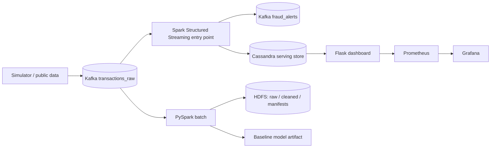

# Báo cáo nghiệm thu kỹ thuật FraudStream

## 1. Mục tiêu và phạm vi bài toán

FraudStream phát hiện rủi ro gian lận trên giao dịch thanh toán trực tuyến.
Đầu vào là sự kiện giao dịch 12 trường đã băm định danh nhạy cảm; đầu ra là
`APPROVE`, `REVIEW` hoặc `BLOCK`, kèm `risk_score` và lý do có thể giải thích.
Hệ thống nhận biết các hành vi online: giao dịch dồn dập trên một thẻ, card
testing (nhiều lần thất bại), nhiều thẻ trên một thiết bị và bất thường giá trị.

Nguồn dữ liệu gồm simulator xác định được seed/scenario để kiểm thử pipeline và
ULB/IEEE-CIS là nguồn dataset công khai cho EDA/baseline. Baseline hiện dùng
**nhãn synthetic**; vì vậy tuyệt đối không diễn giải metric của nó như hiệu quả
phát hiện fraud trên dữ liệu sản xuất.

## 2. Đối chiếu Lambda Architecture với hiện thực



| Layer / thành phần | Hiện thực trong repo | Bằng chứng kiểm thử | Trạng thái chính xác |
|---|---|---|---|
| Ingestion | `data-generator/`, Kafka 3 topic pipeline | `make integration`: 100 simulator events Kafka → HDFS, checksum SHA-256 | Chạy trên Kind |
| Batch | `spark-batch/spark_job.py`, validation/routing, Snappy Parquet, curated feature windows | `make spark-test`: input 4, valid 1, invalid 1, duplicate 1, late 1, cleaned/curated 1 | Chạy local PySpark |
| Storage | HDFS raw/cleaned/curated/manifests, Cassandra risk/alert/read model | HDFS write/read/persistence verifier; Cassandra smoke | Chạy trên Kind |
| Speed | `streaming/engine.py`, `stream_job.py`, `spark_structured_job.py` | Spark Kafka smoke: `numInputRows=1`, lag=0, output part file + `_SUCCESS`, checkpoint | Hoàn thành |
| Serving/UI | Flask, Cassandra `dashboard_recent_decision` read model | Browser UI hiển thị `ui_e2e_velocity_001`, `REVIEW`, score 0.60 | Chạy trên Kind |
| Observability | `/metrics`, Prometheus, Grafana, kube-state-metrics | Prometheus target dashboard/scoring/kube-state healthy; Grafana API trả dashboard provisioned | Chạy trên Kind |
| ML | Spark MLlib Logistic Regression + Random Forest và baseline artifact | `make spark-ml-test` tạo model + metrics, `make train-baseline` tạo comparison artifact | Chạy local Spark |

## 3. Data contract và xử lý dữ liệu

Event dùng `transaction_id` làm khóa idempotency và `event_time` UTC để tính
watermark. Mỗi event đi theo thứ tự cố định:

1. Validate schema/constraint; lỗi sang `transactions_invalid` / route `invalid`.
2. Deduplicate `transaction_id`; lỗi `DQ-08` sang route `duplicate`.
3. So sánh event time với watermark 10 phút; trễ sang `late_events` / `DQ-09`.
4. Event hợp lệ được tính cửa sổ: `tx_count_5m`, `failed_tx_count_10m`,
   `unique_cards_per_device_1h`.
5. Ghi batch valid vào Snappy Parquet partition `event_date`; online result ghi
   Cassandra. `REVIEW`/`BLOCK` phát Kafka `fraud_alerts`.

Batch manifest bắt buộc chứa batch ID, input checksum, input/output counts,
schema version, watermark, partition và trạng thái `COMMITTED`. Batch ID đã có
commit bị chặn để tránh ghi chồng output.

## 4. UI và observability

`dashboard/app.py` dùng Cassandra read model riêng thay vì quét bảng theo card
partition bằng `ALLOW FILTERING`. Streaming sink ghi đồng thời:

- `transaction_risk`: truy vấn theo lịch sử thẻ;
- `fraud_alert`: luồng điều tra alert;
- `dashboard_recent_decision`: feed `recent` giới hạn 50 bản ghi cho UI.

Triển khai local dùng `make monitoring`: build image, nạp vào Kind, deploy
dashboard, scoring worker, Prometheus, Grafana và kube-state-metrics. Prometheus
scrape endpoint mỗi 15 giây; Grafana tự nạp datasource và dashboard vận hành.

Các metric ứng dụng:

| Metric | Ý nghĩa |
|---|---|
| `fraudstream_events_total{route}` | Số event theo scored/invalid/duplicate/late |
| `fraudstream_decisions_total{decision}` | Số APPROVE/REVIEW/BLOCK |
| `fraudstream_event_processing_seconds` | Histogram thời gian chấm điểm mỗi event |
| `fraudstream_kafka_consumer_lag` | Lag consumer Kafka của scoring worker |
| `fraudstream_spark_*` | Input/processed rate, batch duration và state rows của Structured Streaming |
| `kube_pod_*` | Pod phase, restart và workload health từ Kubernetes |

## 5. Kết quả chạy gần nhất

| Lệnh / kiểm tra | Kết quả |
|---|---|
| `python3 -m pytest tests -q` | **35 passed**, 1 cảnh báo phụ thuộc `pytz` |
| `make spark-test` (OpenJDK 17) | PySpark tạo Parquet; manifest: `4/1/1/1/1` (input/valid/invalid/duplicate/late) |
| `make train-baseline` | PR-AUC 0.8190, ROC-AUC 0.5234, precision 1.0, recall 0.0234, F1 0.0458; synthetic only |
| `make spark-ml-test` | Spark MLlib train Logistic Regression + Random Forest; Logistic Regression selected, validation PR-AUC 0.7707, test PR-AUC 0.8445 |
| `make spark-optimization-test` | UDF, BroadcastHashJoin, SortMergeJoin, cache/persist, partition pruning and physical plans verified |
| `make benchmark` | 1,000 events: 88,346 events/s, p50 0.007 ms, p95 0.031 ms on the local scoring engine |
| Cluster workload | Kafka, HDFS NameNode/DataNode, Cassandra, dashboard, Prometheus, Grafana đều `Running`/rollout thành công |
| Prometheus | dashboard + scoring targets healthy (`up=1`); `fraudstream_decisions_total`: APPROVE=104, REVIEW=1 after velocity test |
| Grafana | datasource/dashboard provisioning thành công; dashboard UID `fraudstream-overview` |
| Kubernetes state | `kube-state-metrics` deployed; Prometheus queries pod phase/status and restart metrics |
| UI browser E2E | Cassandra-backed UI hiển thị alert velocity `tx_e2e_velocity_06`: `REVIEW`, risk 0.60, lý do `tx_count_5m >= 5` |

## 6. Lệnh tái lập và demo

```bash
# Hạ tầng stateful + Kafka → HDFS smoke
make reproduce
make persistence

# Code/test
python3 -m pytest tests -q
export JAVA_HOME=/opt/homebrew/opt/openjdk@17/libexec/openjdk.jdk/Contents/Home
export PATH=/opt/homebrew/opt/openjdk@17/bin:$PATH
make spark-test
make train-baseline
make spark-ml-test
make spark-optimization-test
make benchmark

# UI + monitoring
make monitoring
kubectl -n fraudstream port-forward svc/fraudstream-dashboard 8080:8080
kubectl -n fraudstream port-forward svc/prometheus 9090:9090
kubectl -n fraudstream port-forward svc/grafana 3000:3000
```

Mở `http://localhost:8080`, `http://localhost:9090/targets` và
`http://localhost:3000/d/fraudstream-overview/fraudstream-overview`.

## 7. Kết luận nghiệm thu

Roadmap hoàn chỉnh gồm ingestion, storage, batch transformation/curated
features, MLlib, Spark Structured Streaming, Cassandra serving, UI,
Prometheus/Grafana và Kubernetes đã có code, manifest, lệnh tái lập và evidence
thực thi. Bảng checklist cập nhật nằm tại
[`docs/week_4/limitations.md`](../week_4/limitations.md).
