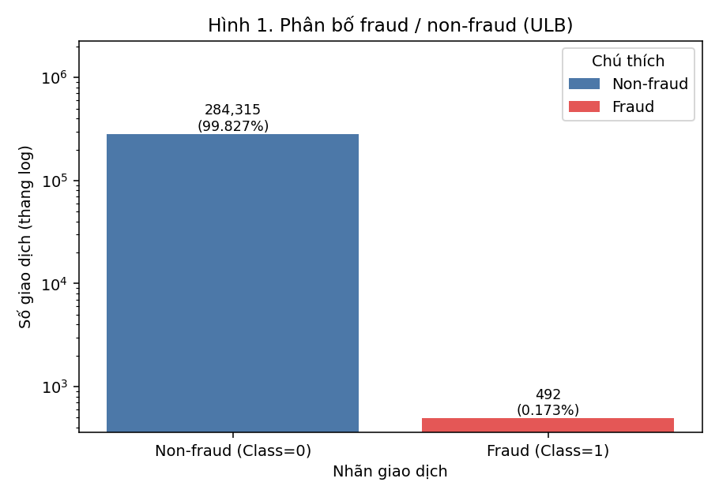
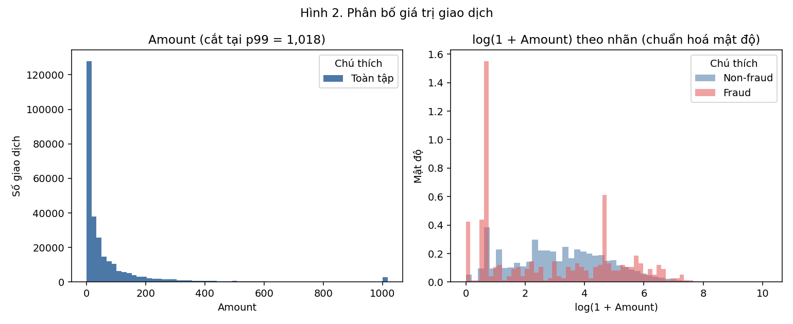
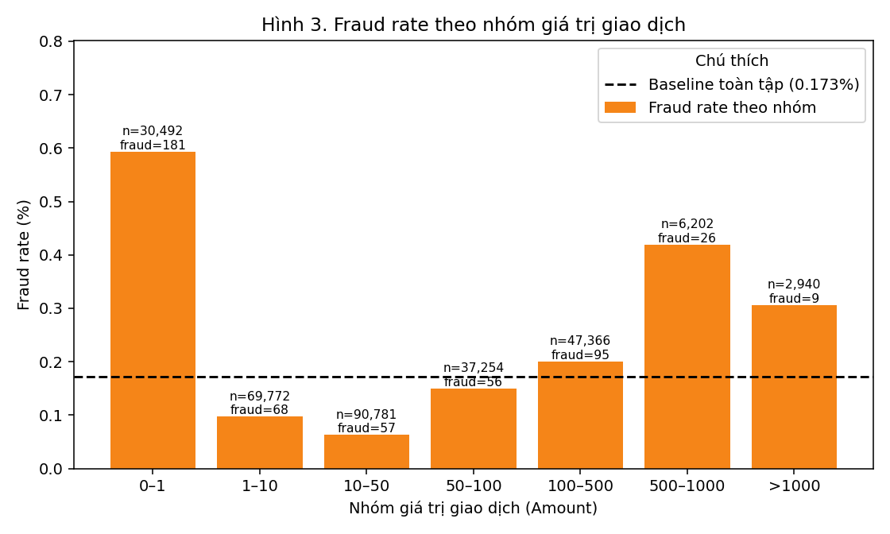
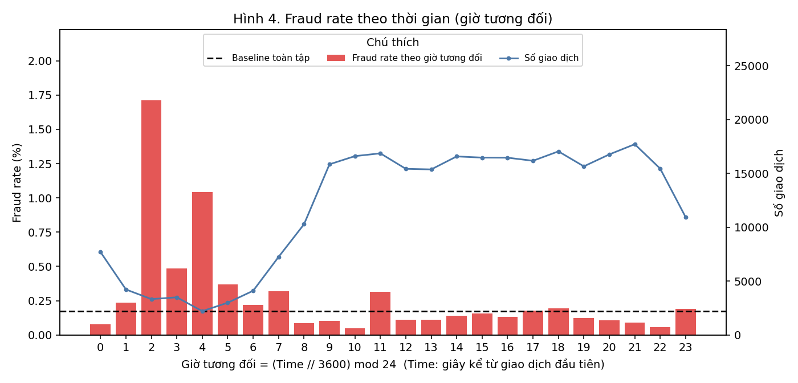
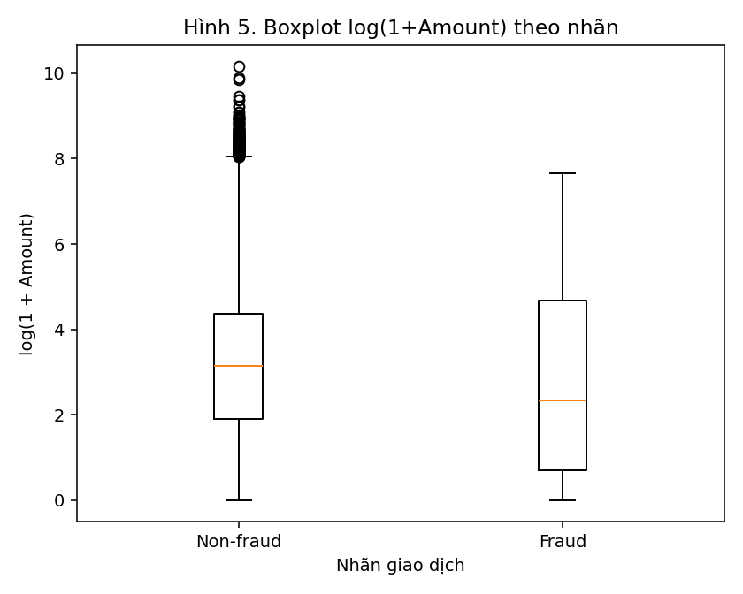
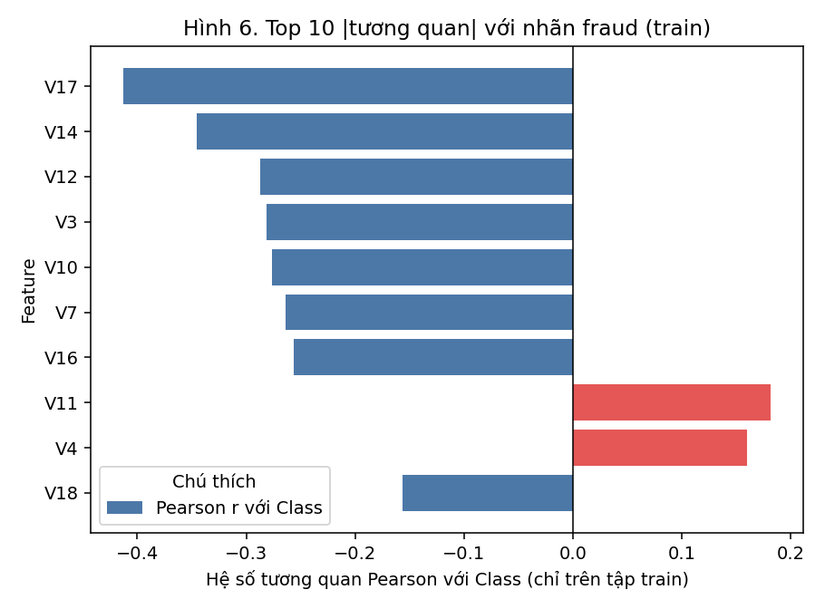

# EDA Report - FraudStream (Tuần 1)

## 1. Mục tiêu và câu hỏi EDA

| # | Câu hỏi | Mục trả lời |
|---|---|---|
| Q1 | Dữ liệu có bao nhiêu giao dịch, tỷ lệ fraud là bao nhiêu? | 2, 4 |
| Q2 | Chất lượng dữ liệu: missing, duplicate, giá trị bất thường? | 3 |
| Q3 | Phân bố `Amount` ra sao, fraud khác non-fraud thế nào? | 5, 6 |
| Q4 | Fraud rate thay đổi theo nhóm amount và theo thời gian ra sao? | 6 |
| Q5 | Cột IEEE-CIS nào map được sang schema giao dịch của dự án? | 7 |
| Q6 | Feature nào đáng đưa vào feature v1 và cần tránh leakage thế nào? | 8, `feature_v1.md` |
| Q7 | Chia train/validation/test theo thời gian có đủ mẫu fraud không? | 6.5 |

## 2. Tổng quan dataset

### 2.1 ULB Credit Card Fraud Detection (dataset chính của EDA)

| Thuộc tính | Giá trị |
|---|---|
| Số dòng | 284,807 |
| Số cột | 31 |
| Khoảng `Time` | 0 – 172,792 giây (≈ 48.0 giờ) |
| Số giao dịch fraud | 492 (0.173%) |

Cột: `Time` (giây kể từ giao dịch đầu tiên), `V1–V28` (thành phần PCA ẩn danh), `Amount`, `Class` (1 = fraud).
Nguồn: https://www.kaggle.com/datasets/mlg-ulb/creditcardfraud

### 2.2 IEEE-CIS Fraud Detection (mapping và mở rộng thiết kế)

_Chưa cung cấp `train_transaction.csv` (tham số `--ieee-transaction`). Mục 7 vẫn mô tả đầy đủ mapping cột; số liệu IEEE-CIS sẽ được điền khi chạy với dữ liệu thật._

## 3. Chất lượng dữ liệu (missing, duplicate)

Dữ liệu không có missing value. Có **1,081** dòng trùng lặp hoàn toàn (0.380% tổng số; 19 dòng thuộc lớp fraud). ULB không có `transaction_id` nên không thể phân biệt duplicate do lỗi phát lại với hai giao dịch thật giống hệt nhau; trong hệ thống streaming, duplicate được xác định bằng `transaction_id`.

## 4. Class imbalance

Tập dữ liệu có **284,807** giao dịch, trong đó **492** fraud (**0.173%**); tỷ lệ non-fraud : fraud ≈ **578 : 1**. Một mô hình luôn dự đoán "không fraud" đạt accuracy **99.827%** nhưng Recall = 0 và không phát hiện được giao dịch fraud nào. Vì vậy accuracy không thể là metric duy nhất; dự án dùng Precision, Recall, F1, PR-AUC và False Positive Rate. Baseline của PR-AUC (mô hình ngẫu nhiên) bằng đúng fraud rate = 0.173%.

## 5. Phân tích `Amount`

| Thống kê | Toàn tập | Non-fraud | Fraud |
|---|---:|---:|---:|
| mean | 88.35 | 88.29 | 122.21 |
| std | 250.12 | 250.11 | 256.68 |
| min | 0.00 | 0.00 | 0.00 |
| p25 | 5.60 | 5.65 | 1.00 |
| median | 22.00 | 22.00 | 9.25 |
| p75 | 77.16 | 77.05 | 105.89 |
| p95 | 365.00 | 364.41 | 640.90 |
| p99 | 1,017.97 | 1,016.97 | 1,357.43 |
| max | 25,691.16 | 25,691.16 | 2,125.87 |
| skew | 16.98 | 17.00 | 3.75 |

Toàn tập: mean = 88.35, median = 22.00, p95 = 365.00, p99 = 1,017.97, max = 25,691.16, skewness = 16.98 → phân bố lệch phải mạnh (mean > median), cần log-transform hoặc chia bin khi mô hình hoá. Median của fraud = 9.25 so với 22.00 của non-fraud (fraud thấp hơn); mean fraud = 122.21 vs 88.29; max fraud = 2,125.87. Có **1,825** giao dịch Amount = 0 (trong đó 27 fraud) → cần quy tắc data-quality riêng cho amount bằng 0.

## 6. Biểu đồ và nhận xét

### 6.1 Phân bố fraud / non-fraud



**Nhận xét:** Tập dữ liệu có **284,807** giao dịch, trong đó **492** fraud (**0.173%**); tỷ lệ non-fraud : fraud ≈ **578 : 1**. Một mô hình luôn dự đoán "không fraud" đạt accuracy **99.827%** nhưng Recall = 0 và không phát hiện được giao dịch fraud nào. Vì vậy accuracy không thể là metric duy nhất; dự án dùng Precision, Recall, F1, PR-AUC và False Positive Rate. Baseline của PR-AUC (mô hình ngẫu nhiên) bằng đúng fraud rate = 0.173%.

### 6.2 Phân bố giá trị giao dịch



**Nhận xét:** Toàn tập: mean = 88.35, median = 22.00, p95 = 365.00, p99 = 1,017.97, max = 25,691.16, skewness = 16.98 → phân bố lệch phải mạnh (mean > median), cần log-transform hoặc chia bin khi mô hình hoá. Median của fraud = 9.25 so với 22.00 của non-fraud (fraud thấp hơn); mean fraud = 122.21 vs 88.29; max fraud = 2,125.87. Có **1,825** giao dịch Amount = 0 (trong đó 27 fraud) → cần quy tắc data-quality riêng cho amount bằng 0.

### 6.3 Fraud rate theo nhóm giá trị giao dịch



| Nhóm Amount | Số GD | Số fraud | Fraud rate |
|---|---:|---:|---:|
| 0–1 | 30,492 | 181 | 0.594% |
| 1–10 | 69,772 | 68 | 0.097% |
| 10–50 | 90,781 | 57 | 0.063% |
| 50–100 | 37,254 | 56 | 0.150% |
| 100–500 | 47,366 | 95 | 0.201% |
| 500–1000 | 6,202 | 26 | 0.419% |
| >1000 | 2,940 | 9 | 0.306% |

**Nhận xét:** Nhóm có fraud rate cao nhất (đủ mẫu) là **0–1**: 0.594% (181/30,492), gấp 3.4 lần baseline 0.173%. Nhóm thấp nhất là **10–50**: 0.063% (57/90,781), bằng 0.4 lần baseline. Nhóm có ít fraud (<3) bị loại khỏi so sánh vì nhiễu. Ý nghĩa nghiệp vụ: amount có mang thông tin nhưng không đủ riêng lẻ → nên so sánh amount với lịch sử của chính thẻ (`amount_vs_avg_7d`) thay vì chỉ dùng ngưỡng tuyệt đối.

### 6.4 Fraud rate theo thời gian (giờ tương đối)



**Nhận xét:** 3 giờ tương đối có fraud rate cao nhất (≥3 fraud): giờ 2: 1.713% (57/3,328); giờ 4: 1.041% (23/2,209); giờ 3: 0.487% (17/3,492); baseline 0.173%. Lưu ý: `Time` là số giây kể từ giao dịch đầu tiên nên đây là giờ **tương đối**, chưa phải giờ đồng hồ; dữ liệu chỉ trải 48.0 giờ nên mỗi giờ chỉ lặp 1–2 lần → kết luận mang tính gợi ý. Trong hệ thống thật nên dùng `hour_of_day` theo múi giờ của chủ thẻ.

<details><summary>Bảng số liệu theo giờ</summary>

| Giờ tương đối | Số GD | Số fraud | Fraud rate |
|---|---:|---:|---:|
| 0 | 7,695 | 6 | 0.078% |
| 1 | 4,220 | 10 | 0.237% |
| 2 | 3,328 | 57 | 1.713% |
| 3 | 3,492 | 17 | 0.487% |
| 4 | 2,209 | 23 | 1.041% |
| 5 | 2,990 | 11 | 0.368% |
| 6 | 4,101 | 9 | 0.219% |
| 7 | 7,243 | 23 | 0.318% |
| 8 | 10,276 | 9 | 0.088% |
| 9 | 15,838 | 16 | 0.101% |
| 10 | 16,598 | 8 | 0.048% |
| 11 | 16,856 | 53 | 0.314% |
| 12 | 15,420 | 17 | 0.110% |
| 13 | 15,365 | 17 | 0.111% |
| 14 | 16,570 | 23 | 0.139% |
| 15 | 16,461 | 26 | 0.158% |
| 16 | 16,453 | 22 | 0.134% |
| 17 | 16,166 | 29 | 0.179% |
| 18 | 17,039 | 33 | 0.194% |
| 19 | 15,649 | 19 | 0.121% |
| 20 | 16,756 | 18 | 0.107% |
| 21 | 17,703 | 16 | 0.090% |
| 22 | 15,441 | 9 | 0.058% |
| 23 | 10,938 | 21 | 0.192% |

</details>

### 6.5 Bổ sung: boxplot amount, tương quan và chia tập theo thời gian





**Nhận xét:** Top 5 theo |r| trên tập train: V17 (-0.41), V14 (-0.35), V12 (-0.29), V3 (-0.28), V10 (-0.28). Các cột V1–V28 là thành phần PCA ẩn danh nên không diễn giải được theo nghiệp vụ; chỉ dùng để dựng **baseline model** trên ULB, không đưa vào feature v1 của hệ thống streaming. Tương quan được tính riêng trên train để không rò rỉ thông tin từ validation/test.

**Chia train/validation/test theo thời gian**

| Tập | Số dòng | Số fraud | Fraud rate | Time (s) từ–đến |
|---|---:|---:|---:|---:|
| train | 170,884 | 360 | 0.211% | 0 – 120,396 |
| validation | 56,961 | 57 | 0.100% | 120,396 – 145,247 |
| test | 56,962 | 75 | 0.132% | 145,248 – 172,792 |

Chia theo thứ tự `Time` (60/20/20), không xáo trộn: train: 170,884 dòng, 360 fraud (0.211%); validation: 56,961 dòng, 57 fraud (0.100%); test: 56,962 dòng, 75 fraud (0.132%).

## 7. Mapping IEEE-CIS → schema giao dịch của FraudStream

Schema đích: `transaction_id`, `event_time`, `customer_id`, `card_id_hash`, `merchant_id`, `amount`, `currency`,
`channel`, `device_id_hash`, `ip_hash`, `country`, `transaction_status` (xem `data_dictionary.md`).

| Trường FraudStream | Cột IEEE-CIS | Mức phù hợp | Ghi chú |
|---|---|---|---|
| `transaction_id` | `TransactionID` | Trực tiếp | Thêm tiền tố `tx_`; dùng để deduplicate |
| `event_time` | `TransactionDT` | Một phần | Là số giây tương đối (delta), không phải timestamp; cần chọn mốc gốc giả định (ví dụ 2017-12-01, quy ước phổ biến trong cộng đồng Kaggle, **không** do ban tổ chức xác nhận) |
| `amount` | `TransactionAmt` | Trực tiếp | Đơn vị tiền tệ không nêu rõ; giả định USD |
| `currency` | — | Không có | Gán hằng số khi chuyển đổi |
| `card_id_hash` | `card1`–`card6` | Xấp xỉ | Không có ID thẻ thật; kết hợp `card1`..`card6` (+`addr1`) rồi băm SHA-256 làm proxy |
| `customer_id` | (suy ra từ nhóm thẻ/địa chỉ) | Xấp xỉ | Không có ID khách hàng; dùng proxy từ `card*` + `addr1` |
| `merchant_id` | `ProductCD` | Yếu | Chỉ là mã sản phẩm (5 giá trị), không phải merchant; chỉ dùng tạm cho phân tích |
| `channel` | `ProductCD`, `DeviceType` | Yếu | `DeviceType` (desktop/mobile) chỉ có ở `train_identity` và thiếu nhiều |
| `device_id_hash` | `DeviceInfo`, `id_30`, `id_31`, `id_33` | Xấp xỉ | Từ `train_identity`; ghép các cột rồi băm; nhiều giao dịch không có identity |
| `ip_hash` | — | Không có | Chỉ simulator tạo được |
| `country` | `addr2` (và `addr1`) | Xấp xỉ | `addr2` là mã quốc gia ẩn danh dạng số, không phải ISO |
| `transaction_status` | — | Không có | Dataset chỉ chứa giao dịch đã ghi nhận; không có giao dịch failed |
| nhãn fraud | `isFraud` | Trực tiếp | Chỉ dùng làm label/`fraud_feedback`, **không** đưa vào event stream |

**Các nhóm cột IEEE-CIS khác:** `C1–C14` (đếm ẩn danh), `D1–D15` (khoảng thời gian ẩn danh), `M1–M9` (cờ khớp
thông tin), `V1–V339` (feature do Vesta thiết kế), `dist1/dist2` (khoảng cách), `P_emaildomain/R_emaildomain`.
Các cột này ẩn nghĩa nên không đưa vào feature v1; có thể dùng cho mô hình batch mở rộng.

**Hệ quả:** IEEE-CIS không có `transaction_status` và `ip`, nên tín hiệu *card testing* (nhiều giao dịch thất bại)
và *device sharing theo IP* **không thể kiểm chứng bằng dữ liệu thật**; hai tín hiệu này dựa vào fraud simulator.

## 8. Feature candidates (rút ra từ EDA)

| Feature candidate | Cơ sở từ EDA | Dataset kiểm chứng được |
|---|---|---|
| `amount_vs_avg_7d` | Amount lệch phải; fraud rate khác nhau theo nhóm amount (6.3) | Simulator, IEEE-CIS (proxy thẻ) |
| `log_amount` | Phân bố lệch phải (6.2) | ULB, IEEE-CIS |
| `tx_count_5m`, `amount_sum_1h` | Tín hiệu velocity | Simulator, IEEE-CIS (proxy thẻ) |
| `failed_tx_count_10m` | Card testing | Chỉ simulator |
| `unique_cards_per_device_1h` | Device sharing | Simulator, IEEE-CIS (proxy thiết bị) |
| `is_new_merchant`, `is_new_country` | Hành vi lạ so với lịch sử | Simulator |
| `hour_of_day` | Fraud rate theo giờ (6.4); cần giờ địa phương thật | Simulator, IEEE-CIS (sau khi chọn mốc gốc) |

Đặc tả đầy đủ, công thức và kiểm tra leakage: xem `docs/feature_v1.md`.

## 9. Giới hạn dữ liệu

1. ULB chỉ có `Time`, `Amount`, `V1–V28`, `Class`: **không có** thẻ, thiết bị, merchant, quốc gia, trạng thái giao dịch → không tính được feature hành vi theo thẻ/thiết bị trên ULB.
2. `Time` là giây tương đối và chỉ trải khoảng 2 ngày → không kiểm tra được cửa sổ 7 ngày, không có tính mùa vụ theo tuần.
3. `V1–V28` ẩn danh (PCA) → không diễn giải được theo nghiệp vụ; chỉ dùng cho baseline.
4. Số lượng fraud rất ít (xem mục 4) → các nhóm/giờ/tập con có thể chỉ có vài fraud, kết luận thống kê có độ bất định lớn.
5. Không có `transaction_id` → không phân biệt được duplicate do phát lại với giao dịch trùng thật.
6. IEEE-CIS: `TransactionDT` tương đối, nhiều cột ẩn nghĩa, missing cao ở nhóm identity/`V*`/`D*`; không có ID thẻ/khách hàng thật.
7. Cả hai dataset đều là dữ liệu quá khứ với nhãn đã được xác nhận; trên hệ thống thật nhãn đến trễ (chargeback), nên đánh giá offline có thể lạc quan hơn thực tế.

## 10. Cách chạy lại

```bash
pip install -r requirements-eda.txt
# đặt creditcard.csv vào data/raw/ (xem data/README.md)
python scripts/eda_ulb.py --data data/raw/creditcard.csv
# tuỳ chọn: thêm profile IEEE-CIS
python scripts/eda_ulb.py --data data/raw/creditcard.csv --ieee-transaction data/raw/ieee/train_transaction.csv
pytest tests/test_eda_pipeline.py
```

Thông tin tái lập:

- File dữ liệu: `creditcard.csv` (150,828,752 bytes)
- SHA-256: `76274b691b16a6c49d3f159c883398e03ccd6d1ee12d9d8ee38f4b4b98551a89`
- Python 3.13.1, pandas 3.0.6, numpy 2.5.4, matplotlib 3.11.2
- Cùng SHA-256 + cùng phiên bản thư viện ⇒ cùng số liệu (script không dùng ngẫu nhiên).
