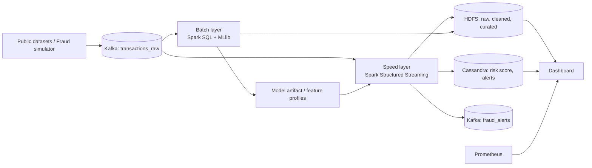

# Bài toán và kiến trúc FraudStream

## 1. Bài toán

FraudStream phát hiện các giao dịch thanh toán trực tuyến đáng ngờ gần thời gian thực. Mỗi giao dịch được tiếp nhận như một event, được kiểm tra chất lượng, kết hợp với lịch sử hành vi rồi gán `risk_score` và quyết định `APPROVE`, `REVIEW` hoặc `BLOCK`.

Các tín hiệu fraud được mô phỏng trong Tuần 1:

| Scenario | Hành vi | Tín hiệu cần quan sát |
|---|---|---|
| `normal` | Lưu lượng hợp lệ, phân tán | Không thực thể nào vượt ngưỡng fraud |
| `card_testing` | Nhiều giao dịch giá trị thấp bị fail | `failed_tx_count_10m >= 3` |
| `velocity_fraud` | Một thẻ giao dịch dồn dập | `tx_count_5m >= 5` |
| `device_sharing` | Một thiết bị dùng cho nhiều thẻ | `unique_cards_per_device_1h >= 3` |
| `high_value_anomaly` | Giá trị cao so với lịch sử thẻ | `amount_vs_avg_7d >= 5` |

## 2. Lambda Architecture

| Layer | Thành phần | Trách nhiệm |
|---|---|---|
| Ingestion | Fraud simulator, Kafka | Tạo, validate và phân phối event theo `card_id_hash` key |
| Speed | Spark Structured Streaming | Deduplicate, watermark, stateful features và online scoring |
| Batch | Spark SQL/MLlib | ETL lịch sử, backfill late events, training và evaluation |
| Storage | HDFS + Parquet | Lưu raw, cleaned, curated, late events, checkpoints và model artifacts |
| Serving | Cassandra + Kafka alerts | Phục vụ risk score/alert mới nhất và luồng cảnh báo |
| Observability | Prometheus + Grafana | Theo dõi throughput, latency, lag, quality và resource metrics |

## 3. Luồng xử lý

1. Simulator tạo event theo [data contract](data_dictionary.md) và dùng `card_id_hash` làm Kafka key.
2. Spark kiểm tra schema/constraint; event invalid được ghi `transactions_invalid`.
3. Event có `transaction_id` đã xử lý bị deduplicate. Event quá watermark đi `late_events` để batch backfill.
4. Các event hợp lệ được enrich và tính features theo `event_time`.
5. Rule engine hoặc model ML tạo score/decision. `REVIEW` và `BLOCK` phát sang `fraud_alerts`.
6. Raw/cleaned/scored data được lưu HDFS; risk score và alert được upsert vào Cassandra.
7. Batch layer dùng data lịch sử và fraud feedback để đánh giá/retrain model.

## 4. Quyết định kỹ thuật Tuần 1

- Sử dụng event time UTC và `transaction_id` làm idempotency key.
- Watermark khởi điểm là 10 phút. Đây là cấu hình rõ ràng cho test; có thể tuning ở giai đoạn streaming.
- `amount <= 0` là invalid. Amount cực lớn vẫn valid vì có thể là tín hiệu fraud.
- Định danh nhạy cảm phải là hash synthetic SHA-256; không ghi số thẻ hoặc IP thật.
- Simulator chạy local bằng JSONL để tái lập; cùng lệnh có thể gửi event vào Kafka khi truyền `--bootstrap-server`.
