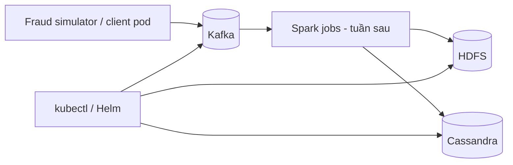

# Mục tiêu Tuần 2: Hạ tầng nền cho FraudStream

> Tuần 2 của nhóm tương ứng với **Tuần 3 - Hạ tầng nền** trong roadmap ban đầu: Kubernetes, Kafka, HDFS và Cassandra.  
> Thành viên phụ trách: **Nguyễn Minh Hoàng, Lê Trọng Đạt và Lê Xuân Nhật Khôi**. Hai thành viên tên Hiếu không thuộc phạm vi Tuần 2.

## 1. Mục tiêu hoàn thành

Kết thúc tuần, dự án có một môi trường Kubernetes tái lập được. Kafka, HDFS và Cassandra cùng hoạt động trong namespace `fraudstream`, dùng persistent storage và có smoke test độc lập. Hạ tầng này là đầu vào cho Spark batch và Spark Structured Streaming ở các tuần sau.

| Mã | Mục tiêu | Cách đánh giá | Mức chất lượng yêu cầu |
|---|---|---|---|
| W2-01 | Kubernetes cluster thống nhất | Kiểm tra node, namespace, DNS và storage class | Có hướng dẫn dựng cluster local tái lập được |
| W2-02 | Kafka hoạt động | Producer/consumer smoke test | 100 event JSON đi và đọc lại đúng key/value |
| W2-03 | HDFS hoạt động | HDFS write/read smoke test | Upload, list và đọc lại được file từ pod client |
| W2-04 | Cassandra hoạt động | CQL smoke test | Keyspace/table, insert/select sample thành công |
| W2-05 | Tích hợp hạ tầng | `verify_infra.sh` | Service DNS, pods, PVC và từng service đều healthy |
| W2-06 | Tài liệu vận hành | Review docs + chạy lại từ máy khác | Có deploy, verify, teardown và troubleshooting cơ bản |

## 1.1. Trạng thái thực hiện hiện tại

Trạng thái dưới đây chỉ đánh dấu các kết quả đã có manifest/script và bằng
chứng kiểm thử tương ứng. `Chưa hoàn tất` không được hiểu là pass có điều
kiện: script xác minh đầy đủ phải trả lỗi cho đến khi hạng mục đó hoàn thành.

| Mã | Trạng thái | Phần đã hoàn thiện | Bằng chứng / nơi xem |
|---|---|---|---|
| W2-01 | Hoàn thành | Kind config đã pin Kubernetes 1.34.11; namespace, quota/limit và preflight kiểm tra node, DNS, StorageClass, PVC mount/read-write. | `infra/kind/`, `infra/platform/`, `infra/scripts/check_preflight.*` |
| W2-02 | Hoàn thành | Kafka KRaft một broker, PVC 5 GiB, 4 topics, bootstrap idempotent, health probes và smoke test 100 events/persistence. | `infra/kafka/`, mục 4 của `week_2_test_evidence.md` |
| W2-03 | Hoàn thành | NameNode/DataNode Ready; hai PVC 5 GiB/8 GiB Bound; bootstrap tạo 6 paths; JSONL I/O/SHA-256 và persistence qua NameNode recreate đều PASS trên Kind. | `infra/hdfs/`, mục 5 `week_2_test_evidence.md` |
| W2-04 | Hoàn thành | Cassandra StatefulSet, PVC 5 GiB, Service nội bộ, probes, CQL bootstrap và smoke test insert/select/persistence. | `infra/cassandra/`, mục 3 của `week_2_test_evidence.md` |
| W2-05 | Hoàn thành | Bash và PowerShell verifier đã chạy trên cluster Kind có đủ 4 workload; kiểm tra platform, Cassandra, Kafka, NameNode/DataNode, 2 HDFS PVC, 6 paths và HDFS I/O đều PASS. | `infra/scripts/verify_infra.*`, mục 5 evidence |
| W2-06 | Hoàn thành | Có deploy, verify, teardown, troubleshooting, Makefile tái lập và review chéo kỹ thuật có evidence runtime cập nhật 25/10/2026. Review/acknowledge nội bộ của các owner vẫn là hoạt động nhóm tiếp theo. | `docs/week_2/week_2_deployment.md`, `docs/week_2/week_2_test_evidence.md`, `docs/week_2/week_2_cross_review.md`, `Makefile` |

### Các cải tiến đã áp dụng cho phần đã có

1. Chuẩn hóa Kind về image đã được dùng trong kiểm thử (`v1.34.11`) và bỏ
   port mapping không được Service sử dụng; truy cập từ máy host dùng
   `kubectl port-forward` khi cần.
2. Preflight không còn chấp nhận PVC `Pending` như một kết quả pass. Nó tạo
   pod tạm, kiểm tra PVC `Bound`, mount và đọc/ghi file trước khi dọn dẹp.
3. Verifier đầy đủ không còn chỉ cảnh báo đối với CoreDNS, schema Cassandra,
   NameNode hay các thư mục HDFS bắt buộc. Mỗi lỗi này làm lệnh trả exit code 1.
4. Xóa Secret Cassandra mẫu có mật khẩu hard-code nhưng không được workload
   sử dụng. Cassandra local hiện chưa bật authentication; khi bật ở giai đoạn
   sau phải tạo Secret ngoài repository hoặc từ secret manager.
5. Smoke test Cassandra xác minh đủ hai transaction mẫu cùng hai quyết định
   `APPROVE` và `BLOCK`, thay vì chỉ kiểm tra một ID và một chuỗi quyết định.
6. Bootstrap HDFS dừng với lỗi nếu DataNode chưa đăng ký; không còn tạo layout
   khi filesystem chưa thể lưu block. Full verifier cũng kiểm tra DataNode, cả
   hai PVC và round-trip I/O/checksum, thay vì chỉ kiểm tra NameNode/path.
7. Sửa Cassandra liveness probe: mở rộng đúng `POD_IP` trong shell thay vì tìm
   chuỗi literal. Sau rollout runtime, Cassandra giữ `Ready` với restart count
   bằng 0 khi liveness probe bắt đầu chạy.

## 2. Phạm vi hạ tầng

Tuần này chỉ dựng nền tảng và chứng minh kết nối/durability cơ bản. Spark jobs, Grafana dashboard, model training và alert UI là đầu việc của các tuần tiếp theo.

## 3. Quy ước chung

| Hạng mục | Quy ước |
|---|---|
| Cluster local | Cả nhóm dùng một lựa chọn được tài liệu hóa: Kind hoặc Minikube |
| Namespace | `fraudstream` cho toàn bộ workload dự án |
| Helm release | Tên có tiền tố `fraudstream-` |
| Service DNS | Dùng `<service>.<namespace>.svc.cluster.local` trong config nội bộ |
| Persistent data | Kafka, HDFS và Cassandra dùng PVC; không dùng hoàn toàn `emptyDir` |
| Configuration | Không hard-code endpoint; dùng ConfigMap, `.env.example` hoặc Helm values |
| Secret | Không commit password/token; dùng Kubernetes Secret hoặc giá trị mẫu an toàn |
| Resources | Mỗi workload có CPU/memory requests và limits phù hợp local environment |
| Documentation | Mọi lệnh deploy/verify/teardown chạy từ root repository |

## 4. Deliverables cuối tuần

| Deliverable | Nội dung tối thiểu | Owner |
|---|---|---|
| `infra/kafka/` | Helm values/manifests, topic bootstrap và Kafka smoke test | Nguyễn Minh Hoàng |
| `infra/hdfs/` | NameNode, DataNode, PVC, data-lake layout và HDFS smoke test | Lê Trọng Đạt |
| `infra/kind/` hoặc `infra/minikube/` | Cluster config, namespace, preflight, resource prerequisites | Lê Xuân Nhật Khôi |
| `infra/cassandra/` | StatefulSet/Helm values, PVC, CQL bootstrap và Cassandra smoke test | Lê Xuân Nhật Khôi |
| `infra/scripts/verify_infra.sh` | Kiểm tra cluster, pod, PVC, Kafka, HDFS, Cassandra | Cả ba |
| `docs/week_2/week_2_deployment.md` | Hướng dẫn cài đặt, deploy, verify, teardown, troubleshooting | Cả ba |
| `docs/week_2/week_2_test_evidence.md` | Bằng chứng smoke test, version, resource footprint, limitations | Cả ba |

## 5. Phân công chi tiết

### Nguyễn Minh Hoàng - Kafka và integration contract

#### Nhiệm vụ

1. Triển khai Kafka trong namespace `fraudstream`, ưu tiên KRaft mode và một broker cho local demo.
2. Viết bootstrap job/script tạo bốn topics: `transactions_raw`, `transactions_invalid`, `fraud_alerts`, `fraud_feedback`.
3. Cấu hình partition count, retention và replication factor phù hợp môi trường local; ghi lý do chọn trong tài liệu.
4. Giữ `card_id_hash` là Kafka message key theo [data contract](data_dictionary.md).
5. Viết Kafka smoke test: phát ít nhất 100 event từ `data-generator/producer.py` hoặc client pod, đọc lại và xác minh JSON/key.
6. Công bố Kafka service endpoint/config mẫu để simulator và Spark jobs dùng chung ở tuần sau.

#### Tiêu chí đánh giá độ hoàn thành

- Kafka broker và PVC liên quan ở trạng thái `Running`/`Bound`.
- Bốn topics tồn tại; bootstrap chạy lặp lại không lỗi khi topic đã có.
- Consumer đọc đủ 100 event, parse JSON thành công và nhận đúng key `card_id_hash`.
- Client pod truy cập Kafka qua service DNS, không dùng port local hard-code.

#### Tiêu chuẩn chất lượng

- Config versioned trong repository; không thao tác cấu hình thủ công không được ghi lại.
- Smoke test trả exit code khác 0 khi broker/topic/consumer không healthy.
- Thiết kế topic nhất quán với schema và luồng dữ liệu của Tuần 1.

#### Gợi ý phương án thực hiện

- Dùng Helm chart có version pin hoặc manifests nhóm quản lý.
- Chạy console producer/consumer trước, sau đó chạy `data-generator/producer.py --bootstrap-server ...` để kiểm tra event thật.
- Đặt configuration vào values file/ConfigMap, không nhúng endpoint trong mã Python.

### Lê Trọng Đạt - HDFS và data-lake foundation

#### Nhiệm vụ

1. Triển khai HDFS gồm NameNode, DataNode, Services và PVC trong namespace `fraudstream`.
2. Ghi resource requests/limits, probes và storage paths của HDFS manifests/values.
3. Tạo data-lake layout: `/fraud-data/raw`, `/cleaned`, `/curated`, `/late_events`, `/checkpoints`, `/models`.
4. Viết HDFS smoke test: upload file JSONL/Parquet mẫu vào `raw`, list, đọc lại và kiểm tra nội dung/checksum.
5. Thiết kế quyền/path convention để Spark batch và streaming cùng dùng ở các tuần tiếp theo.
6. Kiểm tra persistence: restart client pod và chứng minh file/directories vẫn tồn tại trên PVC.

#### Tiêu chí đánh giá độ hoàn thành

- NameNode/DataNode healthy; PVC cần thiết ở trạng thái `Bound`.
- Có đủ sáu thư mục data lake và mỗi thư mục có mục đích được tài liệu hóa.
- HDFS read/write smoke test pass từ pod client trong namespace.
- Restart client pod không làm mất directory/file đã ghi.
- HDFS service endpoint dùng được qua internal DNS.

#### Tiêu chuẩn chất lượng

- HDFS data không nằm trên `emptyDir` khi yêu cầu tồn tại qua restart.
- Script tạo path dùng `mkdir -p`, có thể chạy lặp lại an toàn.
- Smoke test không chỉ kiểm tra command exit code mà còn xác minh nội dung file.

#### Gợi ý phương án thực hiện

- Bắt đầu một DataNode cho local demo, ghi rõ cách mở rộng nhiều DataNode.
- Dùng `hdfs dfs -mkdir -p`, `-put`, `-ls`, `-cat` từ client pod.
- Lưu curated data ở Parquet + Snappy trong tuần batch; Tuần 2 chỉ cần kiểm tra HDFS có thể lưu file mẫu.

### Lê Xuân Nhật Khôi - Kubernetes platform và Cassandra

#### Nhiệm vụ

1. Chọn và chuẩn hóa cách dựng Kubernetes local (Kind hoặc Minikube), gồm cluster config và yêu cầu Docker resources.
2. Tạo namespace `fraudstream`, labels, resource quota/limit range, StorageClass/PVC preflight và DNS check.
3. Viết scripts/manifests kiểm tra node ready, image pull, internal DNS và volume provisioning.
4. Triển khai Cassandra bằng StatefulSet/Helm chart có PVC, Service, readiness/liveness probes.
5. Thiết kế CQL theo access pattern: query risk score/alert theo `card_id_hash` và event time.
6. Viết CQL bootstrap cho keyspace `fraudstream`, bảng `transaction_risk`, `fraud_alert`; làm cho script có thể chạy lặp lại.
7. Viết Cassandra smoke test: insert/select sample từ client pod và kiểm tra dữ liệu sau client pod restart.
8. Soạn ConfigMap/Secret mẫu và phần cluster/Cassandra trong deployment guide.

#### Tiêu chí đánh giá độ hoàn thành

- Một thành viên khác dựng cluster/namespace theo tài liệu mà không cần bước thủ công không được ghi lại.
- `kubectl get nodes`, pods và PVC trong `fraudstream` phản ánh trạng thái healthy/Bound.
- Cassandra node hiển thị healthy (`UN` hoặc trạng thái tương đương).
- CQL insert/select trả lại đúng `transaction_id`, `risk_score`, decision và event time.
- Cassandra service truy cập được qua DNS nội bộ; không dùng `ALLOW FILTERING` trong smoke test.

#### Tiêu chuẩn chất lượng

- Không commit plaintext password/token.
- Stateful workload dùng PVC, readiness/liveness probes và resource requests/limits.
- Cluster preflight/teardown không tác động dữ liệu ngoài namespace/workspace dự án.

#### Gợi ý phương án thực hiện

- Ưu tiên Kind nếu cần config cố định cho local/CI; Minikube nếu StorageClass đơn giản hơn. Chọn một hướng làm chuẩn.
- Bắt đầu Cassandra một node cho demo local và ghi rõ replication factor/cách mở rộng.
- Dùng `cqlsh` trong client pod để tránh phụ thuộc cài Cassandra client trực tiếp trên máy thành viên.

## 6. Cân bằng khối lượng giữa ba thành viên

| Tiêu chí | Nguyễn Minh Hoàng | Lê Trọng Đạt | Lê Xuân Nhật Khôi |
|---|---|---|---|
| Phần sở hữu | Kafka event platform | HDFS data-lake platform | Kubernetes platform + Cassandra serving store |
| State/Persistence | Broker, topics, retention, offsets | NameNode/DataNode, PVC, data-lake paths | Cluster storage/DNS + Cassandra StatefulSet/PVC |
| Smoke test | Producer-consumer 100 event | File write/read/checksum | Preflight + CQL insert/select/restart |
| Tài liệu | Topic/config/endpoints | Storage layout/recovery | Cluster/Cassandra/resources/secrets |
| Điểm tích hợp | Simulator/Spark ingestion | Spark batch/streaming storage | Namespace/service conventions + online serving |

Khôi đảm nhiệm hai lớp có quan hệ chặt chẽ: platform setup là điều kiện để Cassandra chạy ổn định; phần Cassandra được giới hạn ở một node local và một access pattern. Vì vậy tổng effort tương đương với Kafka hoặc HDFS: một workload chính, một smoke test độc lập và một phần tài liệu vận hành.

## 7. Kế hoạch theo ngày

| Ngày | Nguyễn Minh Hoàng | Lê Trọng Đạt | Lê Xuân Nhật Khôi | Mốc kiểm tra chung |
|---|---|---|---|---|
| 1 | Chọn Kafka chart/manifests, estimate resources | Chọn HDFS chart/manifests, design storage | Chọn Kind/Minikube, tạo cluster/namespace | Chốt chuẩn cluster local |
| 2 | Deploy broker/service | Deploy NameNode/DataNode/PVC | Viết preflight: node, DNS, StorageClass | Pod client phân giải DNS |
| 3 | Bootstrap topics, producer/consumer test | Tạo data-lake layout, HDFS I/O test | Deploy Cassandra + PVC/probes | Kafka/HDFS/Cassandra healthy |
| 4 | Hoàn thiện topic config + endpoint docs | Hoàn thiện persistence/restart test | CQL schema + bootstrap + CQL test | Ba service basic I/O PASS |
| 5 | Tích hợp Kafka vào `verify_infra.sh` | Tích hợp HDFS vào `verify_infra.sh` | Tích hợp cluster/Cassandra vào script | Một script kiểm tra đầy đủ |
| 6 | Review manifests của Đạt/Khôi | Review manifests của Hoàng/Khôi | Review manifests của Hoàng/Đạt | Sửa theo review |
| 7 | Kafka evidence + troubleshooting | HDFS evidence + troubleshooting | Cluster/Cassandra evidence + troubleshooting | Demo deploy -> verify -> teardown |

## 8. Checklist nghiệm thu

- [x] Có một cluster local chuẩn và namespace `fraudstream`.
- [x] Kafka có bốn topics; consumer đọc 100 events hợp schema và đúng key.
- [x] Kafka topic bootstrap chạy lặp lại an toàn.
- [x] HDFS có PVC và đủ layout `raw/cleaned/curated/late_events/checkpoints/models`.
- [x] HDFS upload/list/read/checksum smoke test thành công, gồm persistence qua NameNode recreate.
- [x] Cassandra dùng PVC, service DNS, readiness/liveness probes.
- [x] Keyspace/bảng CQL phục vụ query theo thẻ + thời gian; sample insert/select thành công.
- [x] `verify_infra.sh` và `verify_infra.ps1` kiểm tra cluster, pods, PVC, Kafka, HDFS và Cassandra.
- [x] Tài liệu có deploy, verify, teardown, known limitations và troubleshooting cơ bản.
- [ ] Hoàng, Đạt, Khôi review chéo manifests/scripts trước khi merge.

## 9. Definition of Done

Tuần 2 hoàn thành khi một thành viên mới có thể, chỉ dựa vào repository:

1. Dựng cluster local và namespace `fraudstream`.
2. Deploy Kafka, HDFS và Cassandra bằng cấu hình đã versioned.
3. Chạy `verify_infra.sh` thành công.
4. Gửi transaction event vào Kafka, lưu/đọc file từ HDFS, và insert/select một risk record trong Cassandra.
5. Restart một client pod mà không mất dữ liệu đã ghi trên persistent storage.

Kết quả smoke test, resource footprint và giới hạn local phải được ghi trong `docs/week_2/week_2_test_evidence.md`.
