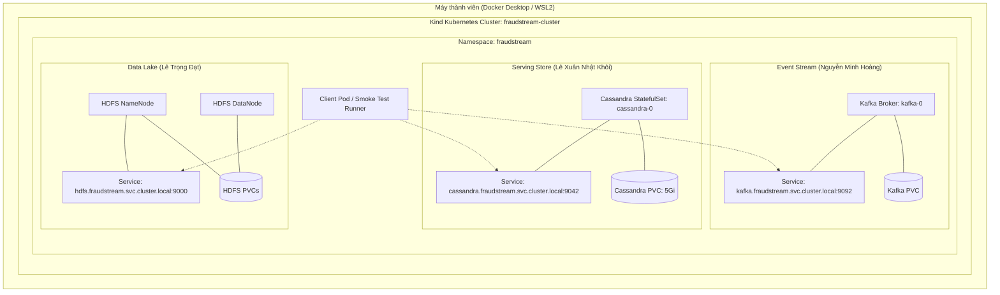

# Hướng dẫn Triển khai Hạ tầng Nền tảng Tuần 2 (FraudStream)

Tài liệu hướng dẫn triển khai môi trường Kubernetes local, cài đặt và kiểm thử bộ ba hạ tầng **Cassandra, Kafka, HDFS** trong namespace `fraudstream`.

---

## 1. Kiến trúc Hạ tầng & Quy ước Chung

Hạ tầng nền tảng Tuần 2 cung cấp nền móng cho pipeline Lambda Architecture của FraudStream:
- **Serving Layer**: Apache Cassandra (StatefulSet 1 node, lưu real-time risk scores và fraud alerts).
- **Ingestion / Speed Layer**: Apache Kafka (1 broker KRaft, tiếp nhận giao dịch từ simulator).
- **Batch / Storage Layer**: Apache HDFS (1 NameNode + DataNode, lưu raw, cleaned, curated Parquet data).



### Bảng Quy ước Đặt tên & Kết nối Nội bộ

| Dịch vụ | Loại workload | Service DNS nội bộ | Port | Storage Class |
|---|---|---|---|---|
| **Cassandra** | StatefulSet (`cassandra-0`) | `cassandra.fraudstream.svc.cluster.local` | `9042` | `standard` (5Gi) |
| **Kafka** | StatefulSet / Pod | `kafka.fraudstream.svc.cluster.local` | `9092` | `standard` |
| **HDFS NameNode** | StatefulSet / Pod | `hdfs-namenode.fraudstream.svc.cluster.local` | `9000` (hoặc `8020`), Web: `9870` | `standard` |

---

## 2. Yêu cầu Tiên quyết (Prerequisites)

1. **Hệ điều hành**: Windows 10/11 (với WSL2), macOS, hoặc Linux Ubuntu 22.04+.
2. **Docker Desktop**:
   - Engine: WSL 2 based engine.
   - Resource allocation: Tối thiểu **8 GB RAM** (khuyên dùng **10–12 GB RAM**) và **4 CPU cores** để chạy đồng thời cả 3 hệ thống phân tán.
   - *Gợi ý cho Windows*: Tạo file `C:\Users\<user>\.wslconfig` với:
     ```ini
     [wsl2]
     memory=10GB
     processors=4
     ```
3. **Các công cụ dòng lệnh (CLI)**:
   - `kubectl` (v1.28+)
   - `kind` (v0.22+)
   - `helm` (v3.14+)
   
   *Cài đặt nhanh trên Windows qua PowerShell:*
   ```powershell
   winget install Kubernetes.kubectl Kubernetes.kind Helm.Helm
   ```

---

## 3. Khởi tạo Platform Kubernetes (Lê Xuân Nhật Khôi)

### Bước 3.1: Dựng Cluster bằng Kind
Từ thư mục gốc của repository:
```bash
# Trên Linux / macOS / Git Bash:
kind create cluster --config infra/kind/kind-cluster.yaml

# Trên Windows PowerShell:
kind create cluster --config infra/kind/kind-cluster.yaml
```
Xác nhận cluster đã sẵn sàng:
```bash
kubectl cluster-info --context kind-fraudstream-cluster
kubectl get nodes
```

### Bước 3.2: Khởi tạo Namespace & Resource Quota
```bash
kubectl apply -f infra/platform/00-namespace.yaml
kubectl apply -f infra/platform/01-resource-quota.yaml
```

### Bước 3.3: Chạy Preflight Check
Kiểm tra tính sẵn sàng của Docker, nodes, CoreDNS và StorageClass:
```bash
# Trên Linux / macOS / Bash:
bash infra/scripts/check_preflight.sh

# Trên Windows PowerShell:
.\infra\scripts\check_preflight.ps1
```

---

## 4. Triển khai Apache Cassandra (Lê Xuân Nhật Khôi)

### Bước 4.1: Áp dụng Cấu hình & Secret
```bash
kubectl apply -f infra/cassandra/cassandra-config.yaml
kubectl apply -f infra/cassandra/cassandra-service.yaml
```

### Bước 4.2: Triển khai Cassandra StatefulSet
```bash
kubectl apply -f infra/cassandra/cassandra-statefulset.yaml
```
Theo dõi trạng thái khởi động pod:
```bash
kubectl get pods -n fraudstream -w
```
*(Cassandra cần khoảng 60–90 giây để hoàn tất khởi động Java process và vượt qua Readiness Probe).*

### Bước 4.3: Chạy Cassandra Smoke Test & CQL Bootstrap
Khởi tạo keyspace `fraudstream`, bảng `transaction_risk`, `fraud_alert`, insert dữ liệu mẫu và chạy truy vấn kiểm thử (không dùng `ALLOW FILTERING`):
```bash
# Trên Linux / macOS / Bash:
bash infra/cassandra/smoke_test.sh

# Trên Windows PowerShell:
.\infra\cassandra\smoke_test.ps1
```

Để kiểm tra cơ chế bền vững dữ liệu (Persistence Test) khi pod bị xóa và dựng lại:
```bash
# Bash:
bash infra/cassandra/smoke_test.sh --test-persistence

# PowerShell:
.\infra\cassandra\smoke_test.ps1 -TestPersistence
```

---

## 5. Triển khai Apache Kafka (Nguyễn Minh Hoàng)

1. Triển khai Kafka broker (KRaft mode, 1 replica) trong namespace `fraudstream`.
2. Tạo 4 topics chuẩn:
   - `transactions_raw` (Partition: 3, Retention: 168h)
   - `transactions_invalid` (Partition: 1, Retention: 72h)
   - `fraud_alerts` (Partition: 3, Retention: 168h)
   - `fraud_feedback` (Partition: 1, Retention: 720h)
3. Chạy smoke test phát tối thiểu 100 event từ simulator:
   ```bash
   python data-generator/producer.py --bootstrap-server kafka.fraudstream.svc.cluster.local:9092 --scenario normal --rate 20 --duration 5
   ```

---

## 6. Triển khai Apache HDFS (Lê Trọng Đạt)

1. Triển khai NameNode, DataNode và Service trong namespace `fraudstream`.
2. Khởi tạo cây thư mục Data Lake:
   ```bash
   kubectl exec -n fraudstream hdfs-namenode-0 -- hdfs dfs -mkdir -p \
     /fraud-data/raw \
     /fraud-data/cleaned \
     /fraud-data/curated \
     /fraud-data/late_events \
     /fraud-data/checkpoints \
     /fraud-data/models
   ```
3. Chạy HDFS smoke test: tải file kiểm thử lên `/fraud-data/raw`, `hdfs dfs -ls` và kiểm tra checksum.

---

## 7. Xác minh Toàn diện Hạ tầng (End-to-End Verification)

Sau khi cả ba thành phần đã được deploy, chạy script xác minh toàn bộ hệ thống:

```bash
# Trên Linux / macOS / Bash:
bash infra/scripts/verify_infra.sh

# Trên Windows PowerShell:
.\infra\scripts\verify_infra.ps1
```

Script sẽ tuần tự kiểm tra:
1. Trạng thái Kubernetes Nodes, CoreDNS và PVCs.
2. Trạng thái Cassandra (`UN`), schema keyspace và smoke test query.
3. Trạng thái Kafka broker và sự hiện diện của 4 topics bắt buộc.
4. Trạng thái HDFS NameNode và 6 thư mục Data Lake chuẩn.

---

## 8. Quy trình Dọn dẹp & Hủy Hạ tầng (Teardown)

Khi muốn tạm dừng hoặc dọn dẹp tài nguyên máy:

### 1. Dọn dẹp workloads trong namespace (giữ cluster):
```bash
kubectl delete namespace fraudstream
```

### 2. Xóa toàn bộ Kind cluster:
```bash
kind delete cluster --name fraudstream-cluster
```

---

## 9. Hướng dẫn Xử lý Sự cố Thường gặp (Troubleshooting)

### 1. Pod Cassandra ở trạng thái `Pending`
- **Nguyên nhân**: Thiếu tài nguyên CPU/RAM hoặc StorageClass không cấp phát được PVC.
- **Cách xử lý**:
  ```bash
  kubectl describe pod cassandra-0 -n fraudstream
  kubectl get pvc -n fraudstream
  ```
  Nếu PVC ở trạng thái `Pending`, kiểm tra xem StorageClass `standard` của Kind có đang hoạt động không (`kubectl get storageclass`).

### 2. Cassandra pod bị `OOMKilled` (Exit code 137)
- **Nguyên nhân**: Docker Desktop bị giới hạn RAM, hoặc Cassandra JVM vượt quá memory limit.
- **Cách xử lý**:
  Đảm bảo trong `infra/cassandra/cassandra-config.yaml` đã set:
  ```yaml
  MAX_HEAP_SIZE: "512M"
  HEAP_NEWSIZE: "128M"
  ```
  Đồng thời kiểm tra file `.wslconfig` để cấp đủ ít nhất 8GB RAM cho WSL2.

### 3. Lỗi kết nối `cqlsh: Connection error`
- **Nguyên nhân**: Cassandra đang trong quá trình khởi động hoặc đang replay commitlog.
- **Cách xử lý**:
  Kiểm tra log pod:
  ```bash
  kubectl logs -f cassandra-0 -n fraudstream
  ```
  Chờ cho đến khi thấy log: `Starting listening for CQL clients on ... (0.0.0.0:9042)` trước khi chạy lệnh cqlsh.
