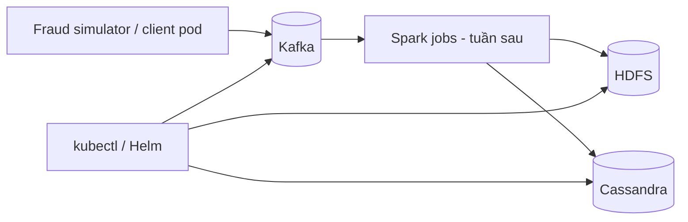

# Mục tiêu Tuần 2: Hạ tầng nền cho FraudStream

> Tuần 2 của nhóm tương ứng với **Tuần 3 - Hạ tầng nền** trong roadmap ban đầu: Kubernetes, Kafka, HDFS và Cassandra.  
> Thành viên phụ trách: **Lê Trọng Đạt** và **Lê Xuân Nhật Khôi**.

## 1. Mục tiêu hoàn thành

Kết thúc tuần, dự án có một môi trường Kubernetes tái lập được, trong đó Kafka, HDFS và Cassandra hoạt động, có persistent storage, health checks và khả năng kiểm tra kết nối giữa các thành phần. Đây là nền tảng cho Spark batch ở giai đoạn sau và Spark Structured Streaming ở giai đoạn tiếp theo.

| Mã | Mục tiêu | Cách đánh giá | Mức chất lượng yêu cầu |
|---|---|---|---|
| W2-01 | Kubernetes cluster thống nhất | Chạy lệnh kiểm tra node/namespace | Có một hướng dẫn dựng cluster local tái lập được |
| W2-02 | Kafka hoạt động trong cluster | Producer/consumer smoke test | Topic tồn tại, event JSON đi và đọc lại được đúng key/value |
| W2-03 | HDFS hoạt động trong cluster | HDFS read/write smoke test | Upload, list và đọc lại được file từ pod client |
| W2-04 | Cassandra hoạt động trong cluster | CQL smoke test | Keyspace/table tạo được; insert/select dữ liệu thử thành công |
| W2-05 | Tích hợp hạ tầng | Kiểm tra service DNS và trạng thái pod | Các service truy cập bằng internal DNS, pods healthy/restart-safe |
| W2-06 | Tài liệu vận hành | Review README/docs + chạy lại từ máy khác | Có lệnh cài, deploy, verify, teardown và troubleshooting cơ bản |

## 2. Phạm vi hạ tầng

Tuần này tập trung làm nền tảng. Spark jobs, Grafana dashboard, model training và alert UI là đầu việc của các tuần tiếp theo; hạ tầng cần được cấu hình sẵn để các thành phần đó có thể kết nối bằng service name.

## 3. Quy ước chung

| Hạng mục | Quy ước |
|---|---|
| Cluster local | Cả nhóm dùng một lựa chọn được tài liệu hóa: Kind hoặc Minikube |
| Namespace | `fraudstream` cho toàn bộ workload dự án |
| Helm release | Tên có tiền tố `fraudstream-`, ví dụ `fraudstream-kafka` |
| Service DNS | Dùng `<service>.<namespace>.svc.cluster.local` trong config nội bộ |
| Persistent data | Kafka, HDFS NameNode/DataNode và Cassandra dùng PVC; không dựa hoàn toàn vào `emptyDir` |
| Configuration | Không hard-code endpoint; dùng ConfigMap / `.env.example` / Helm values |
| Secret | Không commit password/token; manifest tham chiếu Kubernetes Secret hoặc giá trị mẫu an toàn |
| Resources | Mỗi workload có CPU/memory requests và limits phù hợp môi trường local |
| Documentation | Mọi lệnh deploy/verify/teardown phải chạy từ root repository |

## 4. Deliverables cuối tuần

| Deliverable | Nội dung tối thiểu | Owner |
|---|---|---|
| `infra/kind/` hoặc `infra/minikube/` | Cluster config, namespace, resource prerequisites | Lê Xuân Nhật Khôi |
| `infra/kafka/` | Helm values/manifests, topic bootstrap job và smoke test | Lê Trọng Đạt |
| `infra/hdfs/` | Manifests/values cho NameNode, DataNode, PVC và HDFS smoke test | Lê Trọng Đạt |
| `infra/cassandra/` | StatefulSet/Helm values, PVC, keyspace/table bootstrap và CQL smoke test | Lê Xuân Nhật Khôi |
| `infra/scripts/verify_infra.sh` | Một entry point chạy kiểm tra cluster, pod, Kafka, HDFS, Cassandra | Cả hai |
| `docs/week_2_deployment.md` | Hướng dẫn cài đặt, deploy, verify, teardown, troubleshooting | Cả hai |
| `docs/week_2_test_evidence.md` | Bằng chứng smoke test, version, resource footprint, known limitations | Cả hai |

## 5. Phân công chi tiết

### Lê Trọng Đạt - Kafka và HDFS

#### Nhiệm vụ

1. Triển khai Kafka trong namespace `fraudstream`, ưu tiên KRaft mode và một broker cho local demo.
2. Tạo bootstrap job/script cho các topics: `transactions_raw`, `transactions_invalid`, `fraud_alerts`, `fraud_feedback`.
3. Cấu hình topic theo data contract: key transaction là `card_id_hash`; ghi rõ partition count, retention và lý do chọn.
4. Viết Kafka smoke test: gửi event từ `data-generator/producer.py` hoặc client pod, rồi đọc lại event và kiểm tra key/value.
5. Triển khai HDFS gồm NameNode, DataNode, Service và persistent volume claims.
6. Thiết kế layout gốc của data lake: `/fraud-data/raw`, `/cleaned`, `/curated`, `/late_events`, `/checkpoints`, `/models`.
7. Viết HDFS smoke test: tạo file JSONL/Parquet mẫu, upload vào `raw`, list và đọc lại từ pod client.
8. Ghi resource requests/limits và các endpoint Kafka/HDFS cần dùng trong config chung.

#### Tiêu chí đánh giá độ hoàn thành

- Kafka broker và HDFS pods ở trạng thái `Running`; PVC yêu cầu ở trạng thái `Bound`.
- Bốn Kafka topics có mặt, có cấu hình được ghi trong tài liệu.
- Producer gửi ít nhất 100 events `normal`; consumer đọc được cùng số event và JSON parse thành công.
- Event lấy từ Kafka giữ `card_id_hash` làm message key.
- HDFS có đủ sáu thư mục dữ liệu; file đã upload đọc lại có checksum hoặc nội dung trùng khớp.
- Restart một pod client không làm mất topic, HDFS directory hay dữ liệu đã ghi trên PVC.

#### Tiêu chuẩn chất lượng

- Không chạy service bằng port local hard-code trong config nội bộ; service DNS là endpoint chuẩn.
- HDFS không dùng `emptyDir` cho dữ liệu cần tồn tại qua pod restart.
- Topic bootstrap script chạy lặp lại được mà không lỗi khi topic đã tồn tại.
- Smoke test trả exit code khác 0 khi một dependency không healthy.

#### Gợi ý phương án thực hiện

- Dùng Helm chart có phiên bản pin hoặc manifests do nhóm quản lý; ghi rõ version trong `values.yaml`/document.
- Chạy Kafka console producer/consumer trước, sau đó dùng `data-generator/producer.py --bootstrap-server ...` để kiểm tra schema thật.
- Dùng `hdfs dfs -mkdir -p`, `-put`, `-ls`, `-cat` trong pod client để tạo smoke test rõ ràng.
- Bắt đầu từ cấu hình một DataNode, sau đó ghi rõ đường nâng cấp lên nhiều DataNode khi cần scale.

### Lê Xuân Nhật Khôi - Kubernetes nền và Cassandra

#### Nhiệm vụ

1. Chọn và chuẩn hóa cách dựng Kubernetes local (Kind hoặc Minikube), kèm cluster config và yêu cầu Docker resources.
2. Tạo namespace `fraudstream`, labels, resource quota/limit range phù hợp local environment và quy ước service account tối thiểu.
3. Viết scripts/manifests để kiểm tra cluster preflight: node ready, DNS, storage class, PVC provisioning và image pull.
4. Triển khai Cassandra trong namespace `fraudstream` bằng StatefulSet/Helm chart có PVC, Service và readiness/liveness probes.
5. Thiết kế CQL schema theo query dự kiến: risk score/alert theo `card_id_hash` và event time; không thiết kế theo chuẩn quan hệ.
6. Viết CQL bootstrap tạo keyspace `fraudstream`, bảng `transaction_risk` và `fraud_alert` với primary key/partition key được giải thích.
7. Viết Cassandra smoke test: insert/select event risk sample từ client pod; xác minh dữ liệu còn sau client pod restart.
8. Viết các ConfigMap/Secret mẫu, `.env.example` và tài liệu vận hành chung gồm deploy, verify, teardown và troubleshooting.

#### Tiêu chí đánh giá độ hoàn thành

- Một thành viên khác có thể dựng cluster và namespace theo hướng dẫn mà không cần thao tác thủ công không được ghi lại.
- `kubectl get nodes`, `kubectl get pods -n fraudstream`, `kubectl get pvc -n fraudstream` cho trạng thái healthy/Bound.
- Cassandra `nodetool status` hiển thị node `UN` hoặc tương đương healthy.
- CQL bootstrap chạy nhiều lần an toàn; insert/select sample trả về đúng transaction/risk score đã ghi.
- Cassandra service truy cập được bằng DNS nội bộ từ pod trong namespace.
- Resource requests/limits, probes, persistence và recovery behavior được ghi rõ.

#### Tiêu chuẩn chất lượng

- Deployment không cần password/plaintext secret commit vào Git.
- Stateful workload dùng PVC và probes thay vì chỉ dựa vào container process đang chạy.
- CQL table xuất phát từ access pattern: query theo thẻ + thời gian, không dùng `ALLOW FILTERING` trong smoke test.
- Cluster preflight và teardown không xóa dữ liệu ngoài namespace/workspace dự án.

#### Gợi ý phương án thực hiện

- Ưu tiên Kind cho CI/local cấu hình cố định hoặc Minikube khi cần StorageClass dễ dùng; chỉ chọn một hướng làm chuẩn.
- Bắt đầu Cassandra một node cho demo local, nhưng ghi rõ replication factor và cách mở rộng.
- Dùng `cqlsh` trong client pod để chạy CQL smoke test; tránh phụ thuộc cài Cassandra client trực tiếp trên máy thành viên.
- Cấu hình endpoint bằng Kubernetes service name và chuyển password vào Secret khi cần authentication.

## 6. Cân bằng khối lượng giữa Đạt và Khôi

| Tiêu chí | Lê Trọng Đạt | Lê Xuân Nhật Khôi |
|---|---|---|
| Hai workload stateful | Kafka + HDFS | Kubernetes platform + Cassandra |
| Nội dung triển khai | Broker/topic lifecycle, data lake persistence, producer-consumer và HDFS I/O | Cluster lifecycle, storage/network prerequisites, Cassandra schema và CQL I/O |
| Smoke tests | Event stream end-to-end và file storage round-trip | Preflight/DNS/PVC và NoSQL insert/select/restart |
| Documentation | Kafka/HDFS configuration, data lake paths | Cluster/Cassandra configuration, secrets/resources/recovery |
| Điểm tích hợp | Endpoint để simulator/Spark ingest và lưu data lake | Namespace/service conventions, serving store endpoint cho Spark |

Mỗi bên sở hữu hai phần có trạng thái, một bộ smoke test và một phần tài liệu vận hành. Hai thành viên cùng review script của nhau trước khi merge.

## 7. Kế hoạch theo ngày

| Ngày | Lê Trọng Đạt | Lê Xuân Nhật Khôi | Mốc kiểm tra chung |
|---|---|---|---|
| 1 | Chọn chart/manifests Kafka/HDFS, ghi resource estimate | So sánh Kind/Minikube, tạo cluster và namespace | Chốt một chuẩn cluster local |
| 2 | Deploy Kafka, kiểm tra broker/service | Viết preflight, kiểm tra DNS/StorageClass/PVC | Pod client phân giải DNS trong namespace |
| 3 | Tạo topics + producer/consumer smoke test | Deploy Cassandra + PVC/probes | Kafka và Cassandra healthy |
| 4 | Deploy HDFS NameNode/DataNode/PVC | Thiết kế keyspace/table, CQL bootstrap | HDFS/Cassandra basic I/O PASS |
| 5 | Viết HDFS data lake layout và smoke test | Viết Cassandra smoke test + config/secret mẫu | Tất cả services truy cập bằng DNS |
| 6 | Tích hợp `verify_infra.sh`, review Khôi | Tích hợp `verify_infra.sh`, review Đạt | Script phát hiện lỗi service/PVC |
| 7 | Bổ sung troubleshooting, cleanup/recovery test | Bổ sung evidence, cleanup/recovery test | Demo dựng mới -> verify -> teardown |

## 8. Checklist nghiệm thu

- [ ] Có một cluster local chuẩn và namespace `fraudstream`.
- [ ] Kafka có bốn topics và consumer đọc được 100 events hợp schema.
- [ ] Kafka topic bootstrap chạy lặp lại an toàn.
- [ ] HDFS có PVC và đủ layout `raw/cleaned/curated/late_events/checkpoints/models`.
- [ ] HDFS upload/list/read smoke test thành công.
- [ ] Cassandra dùng PVC, service DNS, readiness/liveness probes.
- [ ] Keyspace/bảng CQL phục vụ truy vấn theo card + thời gian; sample insert/select thành công.
- [ ] `verify_infra.sh` kiểm tra cluster, pods, PVC, Kafka, HDFS và Cassandra.
- [ ] Tài liệu có deploy, verify, teardown, known limitations và troubleshooting cơ bản.
- [ ] Đạt và Khôi review chéo manifests/scripts trước khi merge.

## 9. Definition of Done

Tuần 2 hoàn thành khi một thành viên mới có thể, chỉ dựa vào repository:

1. Dựng cluster local và namespace `fraudstream`.
2. Deploy Kafka, HDFS và Cassandra bằng cấu hình đã versioned.
3. Chạy `verify_infra.sh` thành công.
4. Gửi transaction event vào Kafka, lưu/đọc một file từ HDFS, và insert/select một risk record trong Cassandra.
5. Restart một client pod mà không mất dữ liệu đã ghi trên persistent storage.

Kết quả smoke test, resource footprint và các giới hạn local phải được ghi trong `docs/week_2_test_evidence.md`.
