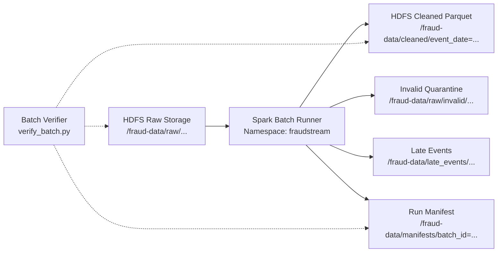

# Hướng dẫn Triển khai và Vận hành Batch Runtime Tuần 4 (FraudStream)

> Deliverables: W4-04 & W4-05  
> Owner: Lê Xuân Nhật Khôi (DevOps & Platform/Monitoring Lead)  
> Phạm vi: Đóng gói runtime Spark Batch trên Kubernetes, runner submit job, kiểm soát tài nguyên và công cụ kiểm thử run manifest/verifier.

---

## 1. Kiến trúc Batch Runtime trên Kubernetes

Pipeline Batch của FraudStream xử lý dữ liệu giao dịch từ tầng Raw (JSONL bất biến) sang tầng Cleaned (Parquet Snappy được phân vùng theo `event_date=YYYY-MM-DD`).



### Thông số kết nối và Cấu hình chuẩn

| Hạng mục | Giá trị chuẩn | Mục đích |
|---|---|---|
| Kubernetes Namespace | `fraudstream` | Namespace cô lập toàn bộ workload |
| Service Account | `spark-batch` | Định danh thực thi trong K8s (`infra/spark/spark-rbac.yaml`) |
| HDFS Core NameNode | `hdfs://hdfs-namenode.fraudstream.svc.cluster.local:9000` | Giao thức distributed file system |
| Raw Ingestion Root | `/fraud-data/raw/transactions_raw/` | Lưu trữ file JSONL gốc bất biến |
| Cleaned Storage Root | `/fraud-data/cleaned/` | Parquet Snappy phân vùng `event_date=YYYY-MM-DD` |
| Invalid Quarantine | `/fraud-data/raw/invalid/` | Bản ghi sai schema hoặc vi phạm ràng buộc |
| Late Storage | `/fraud-data/late_events/` | Bản ghi trễ quá watermark 10 phút |
| Manifests Storage | `/fraud-data/manifests/` | Audit run manifest theo từng `batch_id` |

---

## 2. Quản lý Tài nguyên (Resource Allocation & Safety)

Tuân thủ Resource Quota đã thiết lập tại [`infra/platform/01-resource-quota.yaml`](../../infra/platform/01-resource-quota.yaml):
- **Quota toàn Namespace**: CPU request tối đa `4`, CPU limit `8`; Memory request tối đa `8Gi`, Memory limit `12Gi`.
- **Cấu hình Spark Batch Job Pod**:
  - `requests.cpu`: `200m` – `250m`
  - `requests.memory`: `256Mi` – `512Mi`
  - `limits.cpu`: `500m` – `1000m`
  - `limits.memory`: `512Mi` – `1536Mi`
  - `restartPolicy`: `Never` (bảo toàn log và exit status khi lỗi, không retry vô hạn che giấu sự cố OOM/Crash).

---

## 3. Quy trình Triển khai Môi trường Batch

### Bước 1: Áp dụng RBAC và ConfigMap
Từ thư mục gốc repository:
```bash
# Áp dụng ServiceAccount và quyền RBAC
kubectl apply -f infra/spark/spark-rbac.yaml

# Áp dụng ConfigMap cấu hình HDFS và Batch constants
kubectl apply -f infra/spark/spark-batch-config.yaml
```

---

## 4. Runbook Vận hành (Submit & Verify)

### 4.1. Submit Batch Job
Lệnh submit sẽ tự động đưa fixture vào đúng đường dẫn HDFS raw, tạo batch runner pod, thực hiện phân loại theo contract `invalid -> duplicate -> late -> valid`, ghi cleaned Parquet và commit run manifest.

- **Trên Linux / macOS / Git Bash:**
  ```bash
  python scripts/submit_batch.py --batch-id batch_fixture_v1
  # hoặc dùng make:
  make batch-submit BATCH_ID=batch_fixture_v1
  ```

- **Trên Windows PowerShell:**
  ```powershell
  .\scripts\submit_batch.ps1 -BatchId batch_fixture_v1
  ```

### 4.2. Verify Output & Audit Run Manifest
Lệnh verifier chạy độc lập, kiểm tra 6 tiêu chí bất biến:
1. File raw JSONL nguyên vẹn trên HDFS (đối soát SHA-256 và line count).
2. Run manifest tồn tại, trạng thái `COMMITTED`, schema version `transaction_event_v1`.
3. Cleaned Parquet tồn tại đúng partition `event_date=YYYY-MM-DD`.
4. Schema cleaned chứa đủ 12 trường hợp đồng + `event_date`.
5. Tính duy nhất: không có `transaction_id` trùng lặp trong cleaned.
6. Metric reconciliation: $\text{input} = \text{valid} + \text{invalid} + \text{duplicate} + \text{late}$, $\text{cleaned} == \text{valid}$.

- **Trên Linux / macOS / Git Bash:**
  ```bash
  python scripts/verify_batch.py --batch-id batch_fixture_v1
  # hoặc dùng make:
  make batch-verify BATCH_ID=batch_fixture_v1
  ```

- **Trên Windows PowerShell:**
  ```powershell
  .\scripts\verify_batch.ps1 -BatchId batch_fixture_v1
  ```

---

## 5. Xử lý Sự cố Thường gặp (Troubleshooting)

| Hiện tượng | Nguyên nhân | Cách khắc phục |
|---|---|---|
| Pod `Pending` | Quá hạn mức ResourceQuota của namespace | Kiểm tra `kubectl describe quota -n fraudstream`, giảm request CPU/RAM của job |
| `HDFS NameNode Unreachable` | Service DNS nội bộ chưa sẵn sàng | Kiểm tra `kubectl get svc -n fraudstream hdfs-namenode` và trạng thái pod `hdfs-namenode-0` |
| `Checksum Mismatch` | File raw trên HDFS bị ghi đè hoặc thay đổi | Đảm bảo đường dẫn raw phân tách theo `batch_id` bất biến |
| `Reconciliation Violation` | Ghi lặp record hoặc rơi rớt record không lý do | Kiểm tra log của `batch_job.py` để xem phân loại lý do `DQ-*` |
